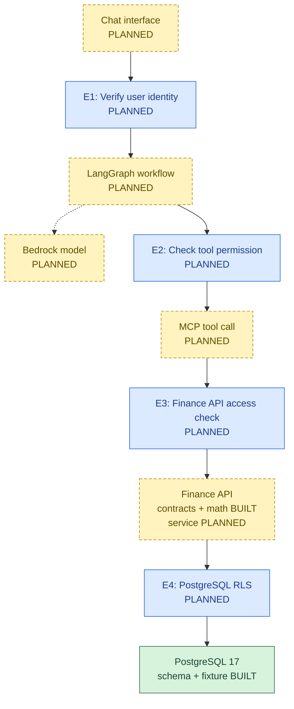
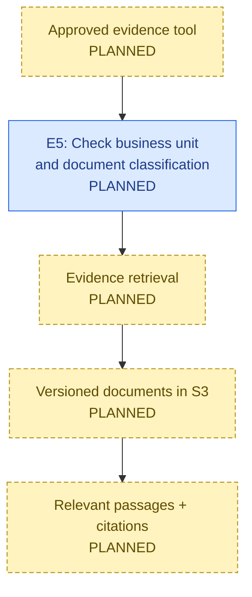
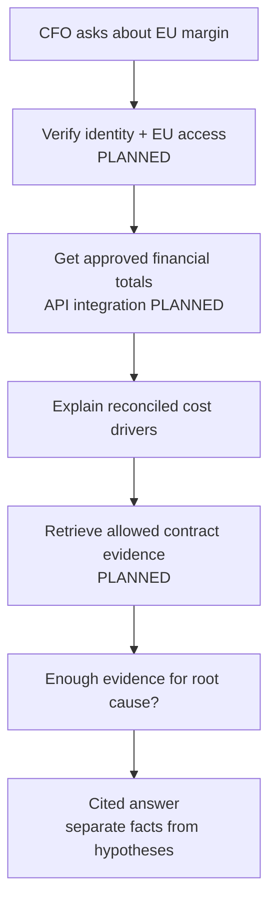

# 01. Enterprise AI Application Architecture

**FIN-AI | Living master design**
**Goal:** Explain the full solution in a few diagrams. Capability details belong in [02 Database](02_Database_And_Financial_Data_Foundation.md) and [03 Finance API](03_Finance_API_Architecture_And_Implementation.md).

**Status key:** **Built** = code exists; **Tested** = stated tests passed; **Planned** = not implemented; **Open** = decision not made.

**Quick terms:** **MCP** = standard tool-call protocol; **RLS** = database row-level security; **IdP** = identity provider (login/token system).

## 1. Business goal and scope

- **Question:** Why did Europe's operating margin fall from **18% (Q1 2026)** to **14% (Q2 2026)**?
- **Data:** Europe (EUR), India (INR), US (USD). PostgreSQL stores financial facts; future S3 retrieval will provide document evidence.
- **MVP:** Read-only financial investigation. No posting, contract editing, or financial approvals.
- **Important:** A cost increase is a *financial driver*, not proof of its root cause. Answers must show sources and uncertainty.

## 2. Overall architecture

- **Finance response:** PostgreSQL aggregate → Finance API calculation → MCP → LangGraph → user. The arrows above show the **request path**, not deployed network connections.
- **AgentCore:** Optional managed hosting/gateway/observability choice. **Not selected or deployed.** LangGraph still owns workflow logic.
- No agent, model, or MCP tool gets direct PostgreSQL credentials.

## 3. Document evidence path

- Retrieved documents are **untrusted content**. Instructions inside a document cannot grant tool access.
- An authorized finance number may be returned even when document evidence is missing, but no unsupported causal claim is allowed.

## 4. Component ownership

| Component | What it does | Current state |
|---|---|---|
| User interface / E1 | Accept question; verify caller | Planned |
| LangGraph | Control steps and tool use; keep trusted identity separate from model text | Planned |
| Bedrock | Interpret question and explain approved results | Planned |
| E2 + MCP | Permit only approved tools and arguments | Planned |
| E3 + Finance API | Check business-unit access; return deterministic financial results | Contracts and math built; rest planned |
| E4 + PostgreSQL | Store financial facts; add row-level protection | Database built; RLS planned |
| E5 + evidence service + S3 | Enforce document access; return cited evidence | Planned |
| AgentCore | Possible hosting, identity and monitoring support | Open choice |

## 5. Security rules

| Check | Where | Non-negotiable rule |
|---|---|---|
| **E1** | Application entry | Validate a real token. JWT signature/issuer/audience checks apply to JWTs; opaque tokens need trusted validation/introspection. |
| **E2** | Agent tool boundary | Check every requested tool, operation and business unit. |
| **E3** | Finance API | **Check again**, even when E2 approved the call. Never trust a model-supplied business-unit permission. |
| **E4** | PostgreSQL | Future RLS, read-only non-owner role, trusted transaction-local context; database context is **not identity proof**. |
| **E5** | Document service | Independently check business unit and document classification before retrieval. |

- **User identity** says *whose data may be used*. **Workload identity** says *which service is calling*. Both matter.
- Keep tokens outside model prompts, agent-editable state, logs and tool arguments. Prefer audience-limited delegation if supported by the chosen IdP.
- Deny access when trusted identity or permission is missing. Do not reveal whether restricted data exists.
- Prevent identity leakage through shared sessions, caches and pooled database connections. No such security tests have run yet.

## 6. CFO investigation flow

## 7. Key choices and failure behavior

| Choice or failure | Decision |
|---|---|
| Arithmetic | PostgreSQL aggregates approved rows; Python `Decimal` calculates profit and margin; the LLM explains. |
| Agent design | Start with one controlled workflow; add multi-agent only if testing shows a need. |
| Deployment | Bedrock planned; AgentCore optional. Confirm region, networking, cost and identity fit before selecting. |
| Unauthorized request | Deny before any protected read. |
| Finance data missing | State data unavailable; **never invent values**. |
| Evidence missing | Show verified financial facts only; root cause remains unproven. |
| Model or tool unavailable | Return a controlled error, or an already authorized deterministic result when appropriate. |
| Reliability | Use end-to-end deadlines, limited safe retries, bounded concurrency, and audit-safe trace IDs. No measured app SLO exists. |

## 8. Evidence and next decisions

| Already built/tested | Still missing |
|---|---|
| PostgreSQL 17, six-table V001 schema; **27 SQL integrity tests** | Application authentication, E2/E3/E5 checks and E4 RLS |
| 240 synthetic records; importer and **4 database integration tests** | Finance API HTTP/service/repository integration |
| SQL reconciliation: EU **18% → 14%** | LangGraph, Bedrock, MCP, evidence retrieval and S3 |
| Pydantic contracts **16 tests**; Decimal math **10 tests** | Negative-access, prompt-injection, integration and load tests |
| Full Python suite: **41 passed, 0 skipped** (recorded) | Hosting choice, telemetry, retention and production operations |

**Next decisions:** IdP/delegation and entitlement source; API/service security; RLS/database roles; model/runtime; evidence versioning; full-flow latency; observability and recovery policy.

**Takeaway:** The **database and calculation foundations work in the tested development scope**. The integrated, secured AI investigation application is **still planned**.
