# Enterprise AI Application Architecture

**Project:** `Finance_Intelligence_And_Investigation_Platform`  
**Architecture scope:** Read-only financial investigation and governed evidence access  
**Status:** Database and application-contract foundations implemented; integrated AI application planned

## 1. Objective and Architecture Scope

I am designing FIN-AI to help a CFO investigate why Europe's operating margin declined from 18% in Q1 2026 to 14% in Q2 2026. The reference company, Meridian Global Manufacturing, contains Europe, India, and United States business units with EUR, INR, and USD data respectively.

The target application must combine two different kinds of work without weakening their trust boundaries:

1. Retrieve and calculate governed financial facts deterministically.
2. Find and summarize relevant documentary evidence without presenting model-generated hypotheses as verified causes.

The MVP is read-only. It may query approved financial aggregates and retrieve authorized evidence, but it must not post transactions, change contracts, close periods, approve adjustments, or modify source systems. Read-only behavior limits impact; it does not remove confidentiality, prompt-injection, authorization, or data-exfiltration risks.

The architecture requirements are:

- **Security:** authenticate every caller, authorize each business-unit and tool operation, propagate identity safely, apply least privilege, and fail closed.
- **Accuracy:** keep financial aggregation and arithmetic deterministic; make the model explain facts rather than create them.
- **Auditability:** correlate each request, authorization decision, model interaction, tool call, source version, and response without logging secrets or excessive financial content.
- **Scalability:** separate stateless request processing from durable data, bound concurrency, pool connections safely, and scale components independently when evidence justifies it.
- **Observability:** measure request, model, tool, database, retrieval, token, error, and latency behavior across one trace.
- **Reliability:** apply timeouts, cancellation, retry classification, dependency isolation, and explicit partial-failure behavior.
- **Governed access:** preserve business-unit and document classifications across API, tool, database, and object-storage boundaries.

The detailed database foundation is recorded in [02_Database_And_Financial_Data_Foundation.md](02_Database_And_Financial_Data_Foundation.md). The implemented Finance API contracts and calculation function are recorded in [03_Finance_API_Architecture_And_Implementation.md](03_Finance_API_Architecture_And_Implementation.md).

## 2. Status Model

I use three status labels throughout this record:

| Status | Meaning |
|---|---|
| **Implemented** | Source exists in the repository and has recorded validation evidence |
| **Designed** | Responsibility or control is specified, but implementation is incomplete |
| **Planned / open** | Candidate capability or decision requiring implementation and validation |

Current implemented scope consists of the PostgreSQL 17 schema, synthetic data generator and importer, database integrity controls, SQL reconciliation evidence, Pydantic v2 Finance API contracts, and deterministic Decimal calculations. No conversational interface, HTTP route, identity provider integration, LangGraph workflow, Bedrock invocation, AgentCore resource, MCP server, S3 evidence repository, retrieval pipeline, or RLS policy has been implemented or deployed.

## 3. Component and Trust-Boundary Architecture

```mermaid
flowchart LR
    classDef implemented fill:#d8f3dc,stroke:#2d6a4f,color:#1b4332
    classDef planned fill:#fff3bf,stroke:#b08900,color:#5f4b00,stroke-dasharray: 5 3
    classDef control fill:#dbeafe,stroke:#2563eb,color:#1e3a8a

    subgraph USER["Trust boundary: User device"]
        UI["Conversational interface\nPLANNED"]:::planned
    end

    subgraph EDGE["Trust boundary: Application entry and identity"]
        ENTRY["API entry / session adapter\nPLANNED"]:::planned
        AUTHN["E1: Inbound authentication\nselected token validation profile\nPLANNED"]:::control
        ENT["Trusted entitlement resolution\nPLANNED"]:::control
    end

    subgraph ORCH["Trust boundary: Agent application runtime"]
        GRAPH["LangGraph workflow\nidentity-aware state and routing\nPLANNED"]:::planned
        POLICY["E2: Tool invocation authorization\nPLANNED"]:::control
        MODEL["Amazon Bedrock model inference\nPLANNED"]:::planned
        MCP["MCP client / gateway boundary\nPLANNED"]:::planned
        HOST["AgentCore managed hosting option\nDECISION OPEN"]:::planned
    end

    subgraph SERVICE["Trust boundary: Deterministic application services"]
        FAPI["Finance API\ncontracts + calculations IMPLEMENTED\nHTTP/repository PLANNED"]:::implemented
        APIZ["E3: Independent Finance API authorization\nPLANNED"]:::control
        RETRIEVE["Evidence retrieval service\nPLANNED"]:::planned
    end

    subgraph DATA["Trust boundary: Governed data stores"]
        PG["PostgreSQL 17\nschema + synthetic data IMPLEMENTED"]:::implemented
        RLS["E4: PostgreSQL RLS\nPLANNED defense in depth"]:::control
        S3["S3 contract/evidence objects\nPLANNED"]:::planned
        S3AUTH["E5: Evidence/document authorization\nPLANNED"]:::control
    end

    UI -->|"access token + question"| ENTRY
    ENTRY --> AUTHN
    AUTHN -->|"verified user context"| ENT
    ENT -->|"verified identity + entitlements"| GRAPH
    GRAPH -->|"prompt without credentials"| MODEL
    MODEL -->|"response / proposed action"| GRAPH
    GRAPH -->|"proposed tool call + immutable context"| POLICY
    POLICY -->|"authorized invocation"| MCP
    MCP -->|"finance request + delegated context"| APIZ
    APIZ -->|"reauthorized request"| FAPI
    FAPI --> RLS
    RLS --> PG
    MCP -->|"evidence request + delegated context"| S3AUTH
    S3AUTH -->|"authorized document scope"| RETRIEVE
    RETRIEVE --> S3
    PG -->|"authorized aggregate"| FAPI
    FAPI -->|"exact result + provenance"| MCP
    S3 -->|"scoped object/version"| RETRIEVE
    RETRIEVE -->|"bounded evidence + citations"| MCP
    MCP -->|"tool responses"| GRAPH
    GRAPH -->|"grounded response"| ENTRY --> UI
    HOST -. "candidate hosting, identity, gateway, observability" .-> GRAPH
    HOST -.-> MCP
```

The diagram shows logical boundaries, not deployed network topology or implemented controls. E1 authenticates inbound callers; E2 authorizes each proposed tool invocation; E3 independently reauthorizes Finance API access; E4 applies planned PostgreSQL RLS as defense in depth; and E5 authorizes evidence and document access. Each transition must carry only the identity, authorization, request, and provenance data needed by the receiving component. A successful check at one boundary does not authorize every downstream action, and no designed path reaches PostgreSQL or evidence objects without its downstream enforcement point.

## 4. Component Responsibilities and Interfaces

| Component | Status | Owns | Must not own | Primary interface boundary |
|---|---|---|---|---|
| Conversational interface | Planned | User interaction, session UX, streaming display, citation presentation | Authorization truth, finance calculations, database credentials | Authenticated application API |
| API entry/session adapter | Planned | Request limits, correlation ID, token extraction, transport parsing, response streaming | Business-unit policy by itself, model reasoning, SQL | Selected OAuth/OIDC token validation or introspection profile and orchestrator invocation |
| Identity provider/token validator | Open | Authentication and trusted token validation appropriate to the selected token format | Financial entitlements unless explicitly governed as claims | Validated identity and claims |
| LangGraph workflow | Planned | Explicit workflow state, routing, retries, evidence collection, human-readable response assembly | Financial arithmetic, independent privilege decisions, secret storage | Typed state and approved tool/model adapters |
| Amazon Bedrock model adapter | Planned | Model request/response translation, model selection configuration, token usage capture | Source-of-record calculations, authorization, unrestricted tool execution | Bedrock inference API |
| AgentCore deployment option | Open | Potential managed runtime, identity integration, gateway, protocol hosting, and telemetry | Business policy or entitlement truth by default | Runtime and gateway service contracts |
| MCP boundary | Planned | Tool discovery/invocation protocol, typed tool schemas, per-call context forwarding | Treating model intent as authorization, exposing arbitrary database access | Narrow read-only tool contracts |
| Finance API | Partial | Strict contracts and deterministic operating-metric calculation are implemented; future route owns aggregate retrieval and error mapping | LLM prompting, contract-document retrieval, authentication by assertion | Planned `GET /v1/finance/operating-margin` |
| PostgreSQL | Implemented foundation | Structured finance facts, constraints, relationships, periods, source references, transaction integrity | Narrative root-cause conclusions, model session state | Parameterized SQL through a least-privilege repository |
| Evidence retrieval service | Planned | Authorized metadata filtering, document/version retrieval, chunk selection, citations | Financial calculation, entitlement invention, unrestricted object access | Narrow evidence-search/retrieve tools |
| S3 evidence store | Planned | Encrypted contract/evidence objects and immutable/version-aware identifiers | Authorization decisions without application/IAM policy, semantic reasoning | Private object APIs through scoped workload identity |

### 4.1 Conversational and orchestration boundary

The conversational layer should present a question and render a grounded answer, but it is not a trusted source of identity or financial truth. User-supplied business-unit codes and natural-language instructions remain untrusted input.

LangGraph is the planned in-application orchestration layer. It should represent steps such as request classification, entitlement evaluation, deterministic finance lookup, evidence retrieval, sufficiency checks, and response composition as explicit state transitions. Workflow state must carry an immutable verified principal and authorized business-unit scope separately from user text and model messages.

The first workflow should use one agent with a small fixed tool set. A multi-agent architecture would add identity propagation, inter-agent authorization, state synchronization, trace correlation, cost, and failure modes before the single-agent behavior is validated.

### 4.2 Bedrock model boundary

Amazon Bedrock is the planned model-inference boundary; no model or API pattern has been selected or invoked. Bedrock currently exposes multiple inference patterns, including a unified Converse interface, but the final choice must follow model, streaming, guardrail, latency, and portability requirements documented by AWS in its [Bedrock API guidance](https://docs.aws.amazon.com/bedrock/latest/userguide/apis.html).

The model may classify an investigation request, propose an allowed tool call, compare authorized facts, and draft a cited explanation. It must not calculate governed financial totals, grant access, construct unrestricted SQL, or convert an unverified hypothesis into a root-cause finding.

Bedrock Guardrails may be evaluated for input and output policy enforcement, but guardrails are not an authorization system and do not neutralize untrusted retrieved instructions by themselves. AWS documents guardrail evaluation around model input and output in its [Guardrails behavior reference](https://docs.aws.amazon.com/bedrock/latest/userguide/guardrails-how.html).

### 4.3 AgentCore deployment considerations

Amazon Bedrock AgentCore is a candidate deployment and operations layer, not an implemented dependency or selected target architecture. Current AWS documentation describes AgentCore Runtime contracts for HTTP and MCP among other protocols, plus identity and observability capabilities. Those managed capabilities could reduce undifferentiated hosting and telemetry work, but they do not replace application authorization, tool policy, data controls, or FIN-AI validation.

If selected, the design must decide separately whether AgentCore hosts the LangGraph application, MCP servers, or both; whether AgentCore Gateway fronts tools; how inbound identity maps to application entitlements; how sessions are isolated; and how private connectivity, deployment promotion, quotas, cost, and recovery are managed. Protocol and container requirements must be validated against the current [AgentCore Runtime service contract](https://docs.aws.amazon.com/bedrock-agentcore/latest/devguide/runtime-service-contract.html) and [MCP runtime contract](https://docs.aws.amazon.com/bedrock-agentcore/latest/devguide/runtime-mcp-protocol-contract.html) before implementation.

### 4.4 MCP tool boundary

MCP is a protocol boundary, not a security boundary by itself. Each tool server must authenticate its caller or accept only a trusted, authenticated gateway path; validate typed arguments; authorize the user and workload for the requested business unit and document scope; enforce timeouts and result limits; and emit auditable decision metadata.

The initial tool catalog should be allowlisted and read-only. Proposed tools include a narrow operating-margin lookup and later evidence search/retrieval. The agent must not receive a generic SQL execution tool, unrestricted S3 object access, or the ability to select its own service credentials. Tool responses should include source identifiers, currency, accounting period, document version, and authorization-safe error information.

## 5. Identity and Authorization Design

All controls in this section are designed or planned; none are implemented.

### 5.1 Inbound identity validation

The API entry must validate the selected OIDC/OAuth access token before creating application state. If JWT access tokens are selected, required checks include the signature against trusted keys, expected issuer, intended audience, expiry and not-before time, accepted signing algorithm, and any required client, scope, or token-type claims. Validation must not rely on claims from an unsigned or merely decoded JWT.

OAuth does not require every access token to be a JWT. If the selected provider issues opaque access tokens, the entry boundary needs a trusted validation or introspection mechanism appropriate to that provider and must not infer identity from the token string. The enterprise IdP and final token profile remain open decisions.

If AgentCore Runtime or Gateway and JWT access tokens are selected, its JWT authorizer is a candidate E1 enforcement point, but FIN-AI must still define allowed issuers, audiences, clients, scopes, and application claims. AWS documents configurable inbound JWT validation for AgentCore Runtime, including discovery URL and allowed-audience/client settings, in its [runtime authentication guidance](https://docs.aws.amazon.com/bedrock-agentcore/latest/devguide/runtime-oauth.html). This candidate does not establish an implemented identity path.

### 5.2 Delegated identity and service identity

Two identities must remain distinct:

- **Delegated user identity** answers who requested the operation and which business units and document classifications that person may access.
- **Service/workload identity** answers which runtime component is calling Finance API, PostgreSQL, Bedrock, or S3 and what technical operations it may perform.

A workload identity must not inherit broad user authority, and a user identifier must not be treated as a service credential. Downstream calls need both a trusted user context and a least-privilege workload credential where user-scoped authorization is required. AgentCore Identity is a candidate for binding user and workload identity, not an implemented control; its documented workload-token behavior must be evaluated against the chosen enterprise IdP and audit model.

The verified user context must be constructed at E1 and entitlement resolution, carried as protected application metadata, and kept outside model-editable messages and tool arguments. Agent state, conversation text, and an untrusted user-ID header are not identity proof. The application may expose the minimum authorized scope needed for reasoning, but it must never forward bearer tokens, workload credentials, or reusable secrets to the LLM.

Where the chosen IdP and downstream service support it, I prefer audience-scoped delegation or token exchange so each service receives a credential intended for that audience and operation rather than the original broadly reusable token. The exact delegation profile remains open, and no token exchange has been implemented.

### 5.3 Business-unit entitlements

The requested `business_unit_code` is data, not proof of access. The application must resolve entitlements from a trusted policy source and evaluate them before any Finance API or evidence call. The minimum authorization tuple is expected to include principal, workload, operation, business unit, resource class, and request context.

E2 must check each proposed tool invocation against the verified identity and entitlement context. E3 must independently enforce business-unit authorization even when E2 approved the call, because model or intermediary intent is not a service authorization decision. E5 must independently enforce business-unit ownership and document classification before evidence retrieval. Errors should fail closed and avoid revealing whether a restricted unit, contract, supplier, or document exists.

### 5.4 Least privilege and RLS

Each runtime component should have a separate workload role with only the required actions. The Finance API repository should use a read-only database role. Evidence retrieval should obtain only scoped S3 read permissions and should not expose reusable credentials to the model.

PostgreSQL RLS is planned as defense in depth. Verified identity and entitlements must originate at the authenticated application boundary; a transaction-local database setting is context, not identity proof. Connection pooling must set that context inside the transaction and reliably clear it before reuse. Database ownership, superuser access, `BYPASSRLS`, maintenance roles, and direct connection paths must be constrained so they cannot become unauthorized bypasses. No RLS policies or negative-access tests exist today.

## 6. Security Threat Scenarios

| Threat | Example failure | Required controls | Current status |
|---|---|---|---|
| Unauthorized business-unit access | An India-scoped user asks for Europe margin or contract evidence | E1 authentication, trusted entitlement lookup, E2 tool authorization, independent E3/E5 authorization, E4 RLS defense in depth, negative tests | Planned |
| Prompt injection in retrieved content | A contract contains text instructing the model to ignore policy or invoke another tool | Treat documents as untrusted data, isolate instructions from evidence, allowlist tools, validate every call, limit retrieved content, cite sources, test adversarial documents | Planned |
| Tool-call privilege escalation | The model changes `EU` to `US`, requests a broader tool, or supplies hidden parameters | Bind E2 calls to non-model-editable verified scope, typed schemas, independent E3/E5 authorization, deny unknown tools/fields | Planned |
| Cross-request identity leakage | A pooled connection, runtime session, cache, or graph state retains the prior user's identity or results | Request-scoped state, secure session keys, transaction-local DB context, pool reset, cache partitioning, concurrency tests, redacted telemetry | Planned |
| Database role or RLS bypass | Service connects as owner/superuser or an administrative path ignores policies | Non-owner read role, no `BYPASSRLS`, restricted network path, audited administration, forced RLS where appropriate, direct-access review | Planned |
| Evidence exfiltration | A retrieval tool returns an unrestricted object URI or excessive document text | Private S3, scoped access, application streaming/proxy, classification filters, response-size limits, no presigned broad access | Planned |
| Model-generated financial error | The model recomputes totals or mixes currencies | Finance API as sole finance tool, Decimal calculations, currency-preserving contracts, reconciliation tests, provenance in response | Partial foundation implemented |

Prompt injection is handled as an authorization and data-handling problem, not only a content-filtering problem. Even if malicious text reaches the model, each attempted tool call must still be constrained by independent policy and least-privilege credentials.

## 7. Primary Investigation Flow

The planned read-only CFO flow is:

1. The interface sends the question and access token to the application entry point.
2. E1 validates the selected token format through its trusted validation profile and establishes a correlation ID and non-model-editable identity context.
3. The authorization layer resolves the caller's permitted business units and resource classifications.
4. LangGraph records the request, verified scope, and workflow state separately from untrusted conversation content.
5. The model may classify the question and propose calls from the allowlisted tool catalog.
6. E2 validates each proposed tool, operation, arguments, and requested scope before MCP invocation.
7. E3 independently reauthorizes the Finance API request; E4 then applies planned RLS before PostgreSQL retrieval. The service uses deterministic Decimal logic to produce financial metrics.
8. If documentary investigation is required, E5 authorizes the business unit and document classification before the evidence service retrieves allowed versions and bounded passages.
9. The model composes an explanation that distinguishes reconciled cost drivers from unproven root-cause hypotheses.
10. The application validates response structure, attaches provenance, records audit-safe telemetry, and streams the result to the interface.

If finance data is unavailable, authorization is denied, evidence is insufficient, or a dependency fails, the workflow should return a bounded error or an explicit statement of uncertainty. It must not substitute generated values or silently omit failed authorization checks.

## 8. Architecture Decisions and Trade-offs

| Decision | Status | Rationale | Trade-off or open point |
|---|---|---|---|
| PostgreSQL is the structured finance source of record | Implemented | Constraints, transactions, exact numeric values, and SQL reconciliation support governed facts | HA, RLS, production operations, and real source integration remain open |
| Finance API mediates agent finance access | Designed | Centralizes contracts, calculations, authorization, error behavior, and provenance | Adds a service hop; route and repository are not implemented |
| No direct agent/database access | Designed | Prevents model-generated SQL and centralizes policy and query grain | Requires a sufficient narrow tool/API catalog |
| Deterministic tools calculate finance; LLM explains | Implemented foundation | Decimal arithmetic is reproducible and testable | Narrative quality and evidence sufficiency still require evaluation |
| LangGraph owns workflow logic | Planned | Explicit graph state and transitions fit bounded investigation workflows | Runtime persistence, checkpoints, retries, and dependency are not selected |
| AgentCore is a deployment option, not the orchestrator design | Open | Managed runtime, identity, gateway, and telemetry may support operations; LangGraph remains application workflow logic | Service fit, portability, cost, regions, private networking, and operational model require evaluation |
| MCP exposes narrow read-only tools | Planned | Standardizes tool discovery and invocation across agent/runtime boundaries | Protocol standardization does not supply business authorization |
| Single agent before multi-agent | Designed | Minimizes identity propagation, coordination, cost, and debugging complexity | May later require specialized subflows after measured need |
| S3 for contract/evidence objects | Planned | Separates binary documents from relational metadata | Version alignment, classification, encryption, lifecycle, indexing, and retrieval are unresolved |

### 8.1 LangGraph versus AgentCore

LangGraph and AgentCore address different layers. LangGraph is the planned application library for workflow state and decision transitions. AgentCore is a candidate managed environment for hosting, identity integration, tool gateway, and observability. Selecting AgentCore would not remove the need to design the graph, authorization checks, tool schemas, and deterministic services. Conversely, selecting LangGraph does not determine where the workflow is deployed.

### 8.2 Finance API versus direct database access

The agent should call a business operation, not receive database credentials. A Finance API boundary can enforce typed inputs, entitlement checks, approved query grain, currency rules, deterministic calculation, stable errors, and provenance. Direct database access would reduce one network hop but would couple agent behavior to schema details and create a materially broader privilege and injection surface.

## 9. Scalability, Reliability, Auditability, and Observability

### 9.1 Scalability and reliability design

The planned application entry, orchestrator, Finance API, and retrieval service should be independently scalable and should keep durable state outside ephemeral workers. Scaling must preserve identity isolation and must not share mutable graph state across users without an explicit partition key.

Each dependency call needs a deadline within the end-to-end request budget. Retries should be limited to transient, idempotent operations and should use bounded backoff. Validation errors, access denial, and deterministic data conflicts are not retryable. Model, tool, database, and retrieval failures require explicit fallback behavior; generated finance values are never a fallback.

The designed failure policy is:

| Condition | Required behavior |
|---|---|
| Unauthorized or unverifiable identity/scope | Fail closed without disclosing protected resource existence or data |
| Missing finance data | Return `DATA_NOT_AVAILABLE` or the final approved equivalent; never invent figures |
| Missing or insufficient evidence | Return verified financial facts only and state that causal conclusions remain unverified |
| Model unavailable | Degrade in a controlled way, returning a deterministic structured result only if the authorized finance operation already succeeded; otherwise return a bounded service error |
| Tool timeout | Stop at the configured deadline, return an explicit bounded failure, and classify retry eligibility only for transient, idempotent operations |

Connection pools must be bounded and must safely reset transaction-local security context. Tool and model concurrency require quotas and backpressure to prevent one investigation or user from exhausting shared capacity. Cache keys must include all authorization and data-version dimensions, or caching should remain disabled for sensitive results until those dimensions are proven.

No numerical latency objective, availability target, concurrency target, or recovery objective has been approved. AgentCore provides documented runtime and observability capabilities, but no FIN-AI AgentCore resource exists and no managed-service guarantee has been validated for this workload. AWS describes AgentCore telemetry through CloudWatch and OpenTelemetry-compatible data in its [observability documentation](https://docs.aws.amazon.com/bedrock-agentcore/latest/devguide/observability.html); adopting it remains an open deployment decision.

### 9.2 Audit and telemetry model

A future end-to-end trace should correlate:

- Request, session, workflow, and tool-call identifiers.
- Authenticated subject and workload identity using privacy-safe identifiers.
- Authorization policy/version, decision, operation, and business-unit scope.
- Model provider, model identifier, prompt-template version, token usage, latency, and guardrail result.
- Tool name/version, sanitized argument dimensions, result status, source/version identifiers, and duration.
- Database query operation name, transaction context, row-count class, and timing without raw credentials or unrestricted SQL logs.
- Evidence object/version, retrieval index version, citation identifiers, and filtering decisions.
- Final outcome, error name, partial-result status, and user-visible provenance.

Logs must exclude access tokens, database passwords, private keys, raw model credentials, and unnecessarily complete financial or contract payloads. Audit events need retention, access control, integrity, and regional handling appropriate to enterprise policy; none of those policies is implemented yet.

## 10. Validation and Current Evidence

| Capability | Status | Evidence and boundary |
|---|---|---|
| PostgreSQL V001 finance schema | Implemented | Six tables, constraints, trigger functions, triggers, and essential indexes executed in PostgreSQL 17 |
| Database integrity | Implemented and tested | 27 SQL tests passed for keys, constraints, periods, triggers, and contracts |
| Synthetic dataset | Implemented and tested | 240 records across six datasets; generator validation recorded |
| Importer | Implemented and tested | One transaction, natural-key resolution, exact-match idempotency, conflict rejection, and rollback; 4 integration tests passed |
| Financial reconciliation | Validated development evidence | Europe changed from 18% Q1 margin to 14% Q2; cost movements reconcile the EUR 4M expense increase |
| Finance API contracts | Implemented and tested | Strict frozen Pydantic request/response models and five error names; 16 focused tests passed |
| Financial calculation | Implemented and tested | Pure Decimal operating-profit/margin function; 10 focused tests passed |
| Full Python suite | Recorded | 41 tests passed with zero skips across multiple project components; this is not end-to-end AI coverage |
| HTTP Finance API and repository | Not implemented | No route, framework, connection pool, or database-to-response integration |
| Identity and authorization | Not implemented | No IdP integration, entitlement service, delegated identity flow, or negative-access tests |
| PostgreSQL RLS | Not implemented | Ownership columns exist; no policies or authenticated context enforcement |
| LangGraph, Bedrock, AgentCore, and MCP | Not implemented | No dependencies, agent graph, model calls, AWS resources, runtime, gateway, or tool server |
| S3 and evidence retrieval | Not implemented | Contract metadata exists; document storage, indexing, retrieval, and citations are planned |
| End-to-end reliability and observability | Not implemented | No approved budgets, integrated traces, resilience tests, or operational deployment |

The current test evidence validates database, ingestion, contracts, and deterministic calculation components in their documented scopes. It does not validate a conversational application, agent safety, authenticated access, prompt-injection resistance, tool authorization, document retrieval, end-to-end latency, or production operation.

## 11. Open Architecture Decisions and Risks

| Decision or risk | Required resolution |
|---|---|
| Enterprise identity provider | Select issuer, token type, claims, audiences, clients, scopes, key rotation, and user lifecycle controls |
| Entitlement source | Define authoritative business-unit and document-classification policy, cache behavior, revocation, and audit evidence |
| Delegated access | Decide how verified user identity and workload identity are bound across runtime, MCP, Finance API, and retrieval calls |
| Runtime deployment | Choose local/container platform versus AgentCore; define networking, scaling, isolation, promotion, rollback, quotas, and cost controls |
| LangGraph state | Decide checkpointing, session persistence, retention, encryption, recovery, and deletion behavior |
| Bedrock model | Select model and inference API using accuracy, region, data policy, latency, context, streaming, and cost evidence |
| MCP topology | Decide direct servers versus gateway, authentication mode, protocol/version strategy, tool discovery policy, and server ownership |
| Authorization enforcement | Define which checks occur at entry, graph policy, service APIs, RLS, and S3; ensure no unchecked bypass path |
| Evidence architecture | Define S3 naming/versioning, document classification, extraction, chunking, index technology, deletion, and citation provenance |
| Prompt-injection defense | Establish adversarial test corpus, content isolation, tool policy, output verification, and incident response |
| Error and latency budgets | Allocate end-to-end deadlines and error semantics across identity, model, tools, database, and retrieval |
| Audit and observability | Define telemetry schema, redaction, retention, access, alerting, trace sampling, and evidence integrity |
| Reliability objectives | Define availability, recovery, dependency degradation, retries, cancellation, and disaster-recovery expectations |

## 12. Takeaway

I implemented the governed database foundation and the deterministic Finance API contract/calculation foundation. I designed the larger application so that identity, authorization, orchestration, model inference, tool access, deterministic finance, and evidence retrieval remain separate responsibilities with explicit trust boundaries.

The target system keeps the LLM outside the financial source-of-truth and authorization boundaries. LangGraph is the planned workflow layer; Bedrock is a planned model boundary; AgentCore is an open managed-runtime option; MCP is a planned narrow tool interface; and S3 evidence retrieval is future work. None of those planned components should be described as deployed or validated until implementation, negative-access testing, adversarial evaluation, resilience testing, and operational evidence exist.
