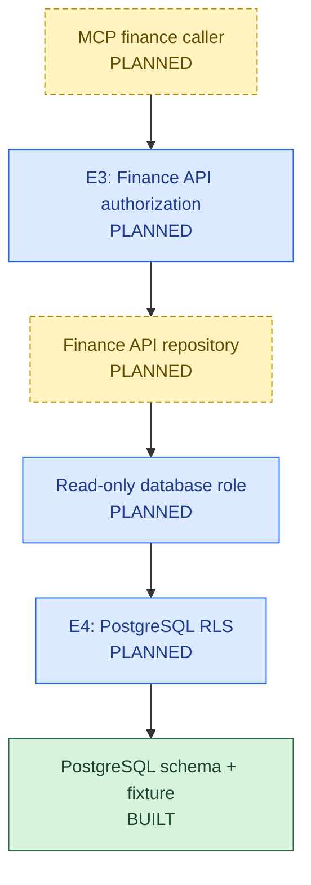
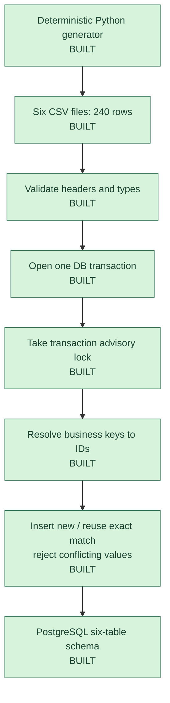
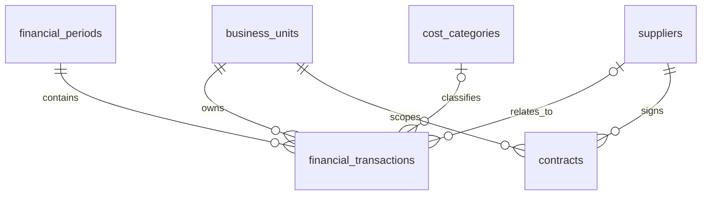
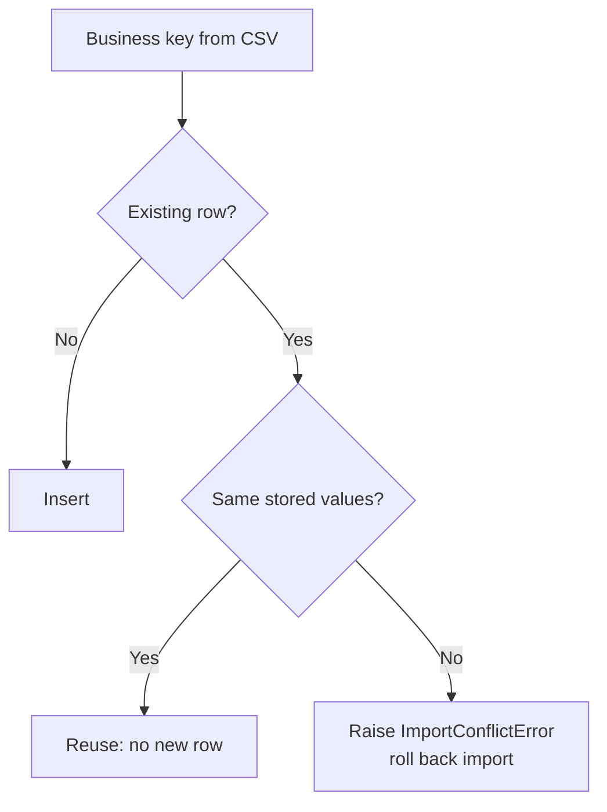

# 02. Database and Financial Data Foundation

**FIN-AI | Capability design + implementation record**
**Master design:** [01 Enterprise Architecture](01_Enterprise_AI_Application_Architecture.md) · **Consumer:** [03 Finance API](03_Finance_API_Architecture_And_Implementation.md)

**Status:** PostgreSQL 17 schema, generator and importer **built and tested**. Finance API repository, least-privilege database roles and E4 RLS **planned**.

## 1. Where this capability fits

**Future finance read path** (planned controls; no agent has direct database access):

**Administrative write path:** The Python importer connects separately using environment-provided database credentials. It does **not** call the Finance API. A dedicated ingestion role is not yet configured.

## 2. Database solution design

### 2.1 Data generation and ingestion

- All CSV input is checked **before** opening the database connection.
- One transaction covers the six datasets. Failure rolls back the attempt.
- The advisory lock only coordinates importers that use the same lock. Other writers can ignore it; concurrent imports have not been tested.

### 2.2 Relationships

| Table | Purpose |
|---|---|
| `business_units` | EU, IN, US ownership and base currencies |
| `financial_periods` | Month, quarter, year and allowed posting dates |
| `cost_categories` | Logistics, raw material and other expense categories |
| `suppliers` | Supplier reference records |
| `financial_transactions` | Revenue/expense facts, status, currency, source reference |
| `contracts` | Supplier contract metadata and classification; **not document content** |

### 2.3 Important design rules

| Rule | How it works | Status |
|---|---|---|
| Financial amounts | PostgreSQL `NUMERIC(18,2)`; Python `Decimal`; positive stored amounts | Built |
| IDs | Internal `BIGINT` identities; import uses stable business/natural keys | Built |
| Duplicate protection | Unique keys, including `(business_unit_id, source_reference)` | Built |
| Idempotency (safe repeat) | Insert missing row; reuse exact match; reject changed values | Built and sequentially tested |
| Period safety | Two triggers reject transaction dates outside their period, including unsafe period edits; `FOR SHARE` lock protects the checked period | Built and tested |
| Reporting | Approved `POSTED` rows, correct business unit, period and currency | Reconciled in development; API query planned |
| Authorization | E3 service check; E4 database RLS; separate read and ingestion roles | **Not implemented** |
| FX | Never add currencies together without an approved FX rule | Policy still open |

## 3. Detailed data operations

### 3.1 Import rules and failure handling

| Failure | Result |
|---|---|
| Invalid CSV/header/type | `DataValidationError` before DB connection, when detected in input parsing |
| Missing reference key | Reject record and roll back |
| Existing key with changed values | `ImportConflictError`; no silent overwrite |
| Constraint or trigger violation | PostgreSQL rejects write; import transaction rolls back |
| Connection lost near commit | Commit outcome may be unknown; check existing business keys before retry |

### 3.2 Transaction and reporting choices

| Concept | What matters **in FIN-AI** |
|---|---|
| **ACID** | One importer transaction avoids partially loaded tables. Local ACID does **not** cover S3 or other services. |
| **WAL (write-ahead log)** | PostgreSQL records changes for crash recovery. **FIN-AI crash restoration has not been tested.** |
| **MVCC (row versioning)** | Queries see suitable stored row versions while other work continues. |
| **Read Committed** | A single finance aggregate sees one statement snapshot; separate statements can see different commits. Default PG behavior; importer does not override isolation. |
| **Repeatable Read** | Use if a future multi-query report requires one stable snapshot. PostgreSQL prevents phantom reads at this level. |
| **Serializable** | Can reject concurrent transactions (`40001`); retry the **whole transaction**. Not the same as linearizability. |
| **CAP (network partitions)** | Relevant if nodes/replicas cannot communicate. Some operations may be denied or delayed to protect consistency. Not a rule for our single Docker node. |
| **Replication/lag** | Future replicas or document indexes may be stale; answer must identify data and document versions. |
| **Outbox/saga** | Possible future ways to coordinate changes across services; **not implemented**. |

**Do not confuse:** ACID consistency (database rules), isolation (concurrent transactions), and distributed consistency (ordering/freshness across nodes).

## 4. Synthetic financial scenario

| Europe (EUR millions) | Q1 2026 | Q2 2026 | Change |
|---|---:|---:|---:|
| Revenue | 100.0 | 100.0 | 0.0 |
| Logistics | 10.0 | 12.5 | +2.5 |
| Raw material | 35.0 | 36.5 | +1.5 |
| Other expenses | 37.0 | 37.0 | 0.0 |
| **All expenses** | **82.0** | **86.0** | **+4.0** |
| **Operating profit** | **18.0** | **14.0** | **-4.0** |
| **Operating margin** | **18%** | **14%** | **-4 points** |

- **240 generated records:** 3 units, 6 periods, 3 categories, 8 suppliers, 216 transactions and 4 contract-metadata rows.
- Logistics and raw materials explain the **expense variance**, not the underlying supplier/operational cause.
- Development reconciliation checked `POSTED` transactions by business unit, period and currency. The original executed SQL text is **not retained**; do not label a later example as the exact historical query.
- Each business unit has 72 transactions in the fixture. Fixture-level currency mismatches: **0**. The schema does not itself enforce base-currency equality.

## 5. Code and test evidence

| Capability | File / evidence | Result |
|---|---|---|
| Database structure and constraints | `db/migrations/V001__initial_finance_schema.sql` | 27 SQL integrity tests passed |
| Synthetic CSV generation | `scripts/generate_synthetic_finance.py` | 11 Python tests passed |
| Atomic/import idempotency | `scripts/import_synthetic_finance.py` | 4 PostgreSQL integration tests passed |
| Initial load | Six synthetic datasets | 240 inserted |
| Reimport | Same datasets | 0 inserted, 240 reused |
| Financial reconciliation | Recorded PostgreSQL aggregation | EU margin 18% to 14% |
| Combined Python suite | Entire repository | **41 passed, 0 skipped** (includes generator, importer and API tests) |

**Query-plan note:** Recorded `EXPLAIN ANALYZE` measurements improved from **0.220 ms to 0.157 ms** after `ANALYZE`. The old plan produced **4 rows**; the displayed quarter-only example in the previous document would produce **2**. The original measured SQL is unavailable, so **these numbers are not performance proof for that example or for production**.

## 6. Current limits and next steps

| Now | Next |
|---|---|
| Schema + constraints + triggers | Enforce close-period and adjustment/audit rules if required |
| Controlled synthetic importer | Dedicated least-privilege ingestion identity, concurrent-import tests |
| Development SQL reconciliation | Named Finance API aggregate query and database-to-response tests |
| Business-unit IDs stored | Read role, transaction-local context, E4 RLS and negative-access tests |
| Single local PostgreSQL instance | Backup/restore, HA, WAL, latency and recovery tests when deployment is defined |
| Currency kept explicit | Approved operating-cost and FX rules, cross-service evidence versions |

**Takeaway:** The database foundation and importer are tested for the stated development cases. **Secure user-scoped reads, HA and production recovery do not exist yet.**
