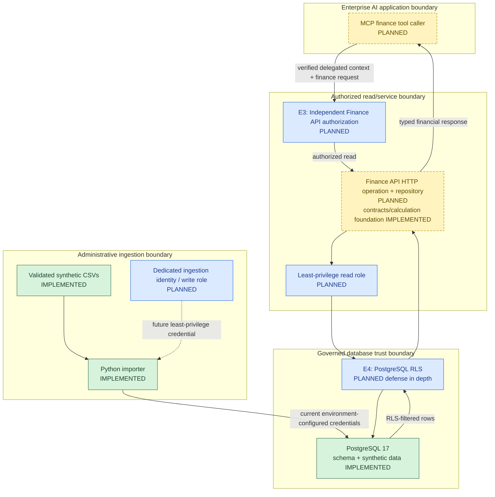
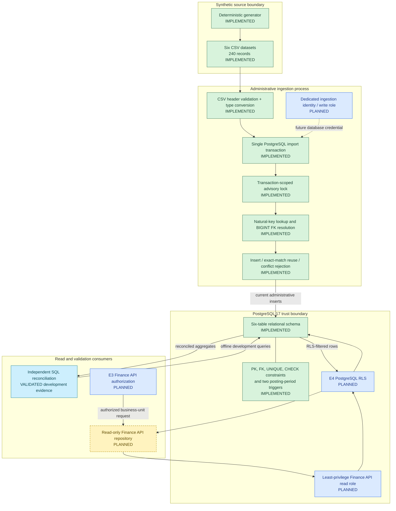
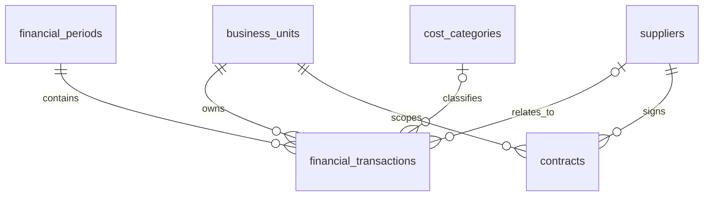

# Database and Financial Data Foundation

**Project:** `Finance_Intelligence_And_Investigation_Platform`
**Scope:** PostgreSQL 17, relational integrity, financial data generation and ingestion, transactional behavior, distributed-systems design, reconciliation, access boundaries, and query performance
**Document type:** Living architecture and engineering implementation record

## 1. Capability Mapping to Enterprise Architecture

The Database capability is the governed structured-data boundary in the overall FIN-AI architecture. I implemented PostgreSQL 17 as the current store for synthetic financial facts, accounting periods, reference data, and contract metadata. The integrated enterprise read path is designed but not implemented: the future Finance API will independently authorize a request at E3, use a least-privilege read repository, and rely on PostgreSQL RLS at E4 as defense in depth.

The Python importer is a separate administrative ingestion path. It writes the six datasets directly through Psycopg using environment-provided database credentials; it does not call the Finance API and is not an agent tool. Its future operational authorization and dedicated write role remain open. This separation prevents the read-only application contract from being confused with controlled data loading.



The diagram is a logical capability mapping, not a claim that E3, E4, database roles, or runtime network controls are active. The approved application design contains no direct agent-to-database path. All future Finance API reads pass through E3 and the planned E4 database boundary. The importer remains outside that service path because ingestion and end-user reads have different identities, permissions, transaction behavior, and audit requirements.

| Capability element | Enterprise dependency and trust boundary | Status |
|---|---|---|
| PostgreSQL structured store | Governed database boundary; source for authorized finance reads | Implemented and development-validated |
| E4 PostgreSQL RLS | Database defense in depth after application authorization | Planned; no policies or tests exist |
| Finance API repository | Authorized read consumer of PostgreSQL aggregates | Planned; HTTP route and repository do not exist |
| E3 Finance API authorization | Independent business-unit authorization before repository access | Designed/planned; not implemented |
| Python importer | Separate administrative ingestion client using parameterized Psycopg SQL | Implemented and integration-tested |
| Ingestion identity and write role | Operational authorization for controlled data loading | Planned; current credentials are environment-configured |
| Agent access | Narrow Finance API/MCP operation only | Designed; direct database access is prohibited |

The Database capability depends on verified upstream user context for future reads, but PostgreSQL does not establish user identity. E3 owns the service authorization decision; E4 consumes trusted transaction-local context only as defense in depth. Administrative ingestion instead depends on an authorized workload identity and change process, not an end-user entitlement.

## 2. Database Capability Solution Architecture

The PostgreSQL capability has two implemented flows and one planned flow: deterministic fixture generation and ingestion, independent reconciliation, and a future authorized Finance API read path.



The transaction block in the diagram represents the implemented `connection.transaction()` context. The advisory lock is acquired inside that transaction before table processing. CSV header and value conversion occurs before the importer opens the database connection. Natural-key resolution and exact-match comparisons occur while the transaction is active.

The planned read flow is deliberately separate: E3 authorizes the Finance API request, the repository uses a read-only database role, and E4 applies row filtering before data is returned. The independent reconciliation path is retained as development validation evidence, not as an application endpoint or an authorization bypass. No agent, MCP component, or model receives PostgreSQL credentials.

## 3. Database Detailed Solution Design

### 3.1 Schema responsibilities and relationships

I implemented the V001 migration with six normalized tables:

| Table | Responsibility | Relationships and ownership |
|---|---|---|
| `business_units` | Defines organizational ownership, region, base currency, and active state | Parent of transactions and contracts; future RLS scope |
| `financial_periods` | Defines canonical monthly periods and stored quarter | Parent of transactions; calendar boundaries constrained |
| `cost_categories` | Classifies operating expenses | Nullable transaction parent; required for expenses by rule |
| `suppliers` | Identifies supplier counterparties | Nullable transaction parent and required contract parent |
| `financial_transactions` | Stores positive revenue and expense facts with source traceability and posting status | Required business unit and period; optional supplier; category conditional on type |
| `contracts` | Stores supplier contract metadata and classification | Required supplier and business unit |



PostgreSQL `NUMERIC(18,2)` and Python `Decimal` preserve two-decimal financial values. Transaction amounts are positive magnitudes, while `transaction_type` supplies revenue or expense meaning. Currency remains explicit on transactions; cross-currency aggregation requires a future governed FX policy.

### 3.2 Key and foreign-key design

I selected `BIGINT GENERATED ALWAYS AS IDENTITY` primary keys for internal relationships and stable natural keys for external data exchange. The importer maps business-unit, period, category, and supplier identifiers to database identities and never assumes sequence values. Foreign keys protect required and nullable relationships.

Unique business keys cover unit, category, supplier, contract, and financial year/month identifiers. `(business_unit_id, source_reference)` prevents duplicate upstream transactions within one owning unit. Normalization reduces contradictory reference data at the cost of join complexity.

### 3.3 Transaction, rollback, and idempotency boundaries

The importer validates and converts all CSV files before opening a database connection. Database work then runs inside one transaction covering the advisory lock, reference-table processing, transaction loading, and contract loading. Any unhandled validation, conflict, constraint, trigger, or database exception aborts that complete write set.

For each natural key, the importer inserts an absent row, reuses an exact existing match, or raises `ImportConflictError` when stored business values differ. It never silently overwrites financial data. The transaction-scoped advisory lock serializes cooperating importer executions that use the same lock identifier, while unique constraints remain the database safeguard for other writers. Sequential idempotency and complete rollback were validated; concurrent importer behavior was not.

### 3.4 Integrity and trigger enforcement

Declarative constraints enforce required values, uniqueness, positive amounts, currencies, transaction and posting types, category rules, period construction, and contract validity. Foreign keys protect relationships.

Two trigger functions enforce the cross-table posting-period invariant. Transaction inserts or date/period changes lock and read the referenced period with `FOR SHARE`; period updates are rejected if they would exclude an existing transaction. These triggers do not enforce period close, authorization, reconciliation, FX, audit, or RLS controls.

### 3.5 Read and aggregation boundary

Independent SQL reconciliation has validated the stored development scenario at business-unit, accounting-period, posting-status, and currency grain. It is not a production Finance API implementation, and the exact historical `EXPLAIN` query remains unavailable as recorded later in this document.

The future Finance API repository is the only approved application read consumer. E3 must independently authorize the requested business unit before repository execution. The repository should expose named, parameterized aggregate operations rather than arbitrary SQL and should use a dedicated read-only role. E4 RLS is planned to filter rows using trusted transaction-local context. No direct agent-to-database access is approved.

### 3.6 Isolation and consistency considerations

The importer does not explicitly select an isolation level; it uses the connection's configured PostgreSQL behavior and adds a cooperative advisory lock. The single transaction prevents partial six-table commits, but concurrent writers that ignore the advisory lock require separate analysis. The posting-period row lock protects one specific cross-table race.

For future reports, one aggregate SQL statement receives one statement snapshot under PostgreSQL `READ COMMITTED`. Multi-statement reporting may need a stronger snapshot strategy. Serializable retries, concurrent reporting behavior, unknown commit outcomes, crash recovery, and replica consistency have not been validated. Sections 7 through 11 retain the detailed ACID, WAL, MVCC, CAP, and distributed-recovery analysis.

### 3.7 Security and RLS boundaries

PostgreSQL currently stores business-unit ownership but does not enforce RLS. E3 is the future Finance API authorization boundary; E4 is planned database defense in depth, not a replacement for E3 or proof of identity. A transaction-local setting can carry verified scope but cannot authenticate a caller.

The read repository and importer require separate least-privilege roles. The read role should not write or bypass RLS. The ingestion role needs only the controlled writes required by the load process and must not become an agent or end-user credential. Database owner, superuser, `BYPASSRLS`, maintenance, migration, and emergency paths need explicit governance. These role and policy controls are not implemented or tested.

### 3.8 Error and failure behavior

| Failure | Implemented or designed behavior |
|---|---|
| Invalid CSV header or value | `DataValidationError` before database connection where detected |
| Missing natural-key reference | Reject the record and abort the import attempt |
| Existing key with different values | Raise `ImportConflictError`; do not update silently |
| Constraint or trigger violation | PostgreSQL rejects the statement and the import transaction rolls back |
| Failure after earlier inserts in the same import | Transaction context rolls back the complete attempt |
| Unauthorized future Finance API read | E3 must fail closed; E4 provides planned additional row filtering |
| Missing financial data | Future API must report data unavailable and must not invent figures |
| Lock wait, deadlock, connection loss, or unknown commit | Operational timeout, retry, and reconciliation policy remains unresolved |

### 3.9 Principal decisions and trade-offs

| Decision | Rationale | Trade-off or limitation |
|---|---|---|
| Normalized PostgreSQL schema | Centralized constraints and trustworthy relationships | Reports require joins; model is not a full general ledger |
| Natural keys plus surrogate identities | Stable external references and efficient internal relationships | Importer must resolve keys during every load |
| One six-table transaction | Prevents partial dataset commits | Larger loads may hold locks and resources longer |
| Exact-match idempotency | Makes sequential retries safe and exposes conflicting data | Authorized corrections need a separate governed process |
| Transaction-scoped advisory lock | Coordinates cooperating importers | Other writers can ignore it; concurrency remains untested |
| Finance API instead of direct agent SQL | Centralizes authorization, query grain, contracts, and provenance | Adds a service boundary that remains unimplemented |
| E3 plus planned E4 | Service authorization plus database defense in depth | Identity propagation, roles, policies, and negative tests remain open |
| Evidence-based indexing | Avoids tuning a 216-row fact table prematurely | Representative workload evidence is still required |

### 3.10 Design-to-code traceability

| Design responsibility | Source file or component | Implementation status | Validation evidence |
|---|---|---|---|
| Six-table schema, constraints, triggers, and indexes | `db/migrations/V001__initial_finance_schema.sql` | Implemented | Migration executed in PostgreSQL 17; 27 SQL integrity tests passed |
| Deterministic synthetic datasets | `scripts/generate_synthetic_finance.py`; `data/synthetic/` | Implemented and validated | 11 generator tests; 240 generated records |
| CSV validation and type conversion | `scripts/import_synthetic_finance.py:load_dataset()` | Implemented and validated | Generator round-trip coverage and importer integration tests |
| Natural-key resolution and parameterized writes | `scripts/import_synthetic_finance.py:import_dataset()` | Implemented and validated | All six datasets loaded; source counts matched |
| Atomic import and rollback | `connection.transaction()` in `import_dataset()` | Implemented and validated | Invalid-input integration test left no isolated test records |
| Exact-match idempotency and conflict rejection | `_assert_match()` and table import loops | Implemented and validated | Reimport unchanged; conflict and duplicate checks passed |
| Importer serialization | `pg_advisory_xact_lock()` in `import_dataset()` | Implemented; concurrency behavior not validated | Code inspection only for concurrency; no concurrent-run evidence |
| Posting-period integrity | Two PL/pgSQL trigger functions in V001 | Implemented and validated | Both trigger directions covered by SQL integrity tests |
| Financial reconciliation | PostgreSQL aggregate validation recorded in this document | Validated development evidence | Europe 18% Q1 and 14% Q2; EUR 4M expense variance reconciled |
| Finance API request/response and arithmetic foundation | `finance_api/contracts.py`; `finance_api/calculations.py` | Implemented and validated, but not database-integrated | 16 contract tests and 10 calculation tests |
| Finance API HTTP repository | Planned component | Planned | No implementation or integration tests |
| E3 business-unit authorization | Enterprise architecture control | Designed/planned | No implementation or security tests |
| Least-privilege read and ingestion roles | PostgreSQL role design | Planned | No role definitions or privilege tests |
| E4 PostgreSQL RLS | PostgreSQL policy design | Planned | No policies, identity context, or negative-access tests |

The current database remains a controlled development fixture rather than a double-entry general ledger or production data platform. It does not implement enforced period close, approvals, adjustments, audit history, governed FX, source-system change capture, HA, or disaster recovery.

## 4. Integrity Controls, Triggers, and Locking

### 4.1 Declarative constraints

I implemented database constraints for invariants that can be evaluated on a row or relationship:

| Control | Implemented rule |
|---|---|
| `NOT NULL` | Required ownership, period, dates, types, amounts, statuses, and identifiers |
| `UNIQUE` | Business-unit, category, supplier, contract, period, and source business keys |
| `CHECK` | Nonblank identifiers, valid currencies, period boundaries, quarter mapping, positive amounts, allowed states, and contract date validity |
| Foreign keys | Transaction and contract references must identify existing parent rows |

Financial transactions allow only `REVENUE` and `EXPENSE`. Expenses require a cost category; revenue must not have one. Posting status is restricted to `DRAFT`, `POSTED`, or `REVERSED`. Contract visibility is restricted to `INTERNAL`, `CONFIDENTIAL`, or `RESTRICTED`, and a contract cannot end before it starts.

Database integrity does not prove business correctness. A valid positive expense may still be assigned to the wrong supplier, category, business unit, or source reference. Constraints establish structural invariants; reconciliation, source governance, approvals, and audit evidence are separate controls.

### 4.2 Cross-table posting-period triggers

A row-level `CHECK` constraint cannot read the referenced `financial_periods` row, so I implemented two complementary trigger functions:

1. Before a transaction insert or a posting-date/period update, `validate_transaction_posting_period()` reads the referenced period and rejects a posting date outside its range.
2. Before a period boundary or date-dimension update, `validate_period_transaction_dates()` rejects a change that would exclude an existing transaction.

The transaction-side trigger selects the period `FOR SHARE`. In PostgreSQL 17, this row lock blocks conflicting updates and deletes of that period while the transaction is active; ordinary reads remain possible. PostgreSQL documents the detailed row-lock conflicts in its [explicit-locking reference](https://www.postgresql.org/docs/17/explicit-locking.html).

This lock addresses the specific race between validating a transaction and changing its referenced period. It does not prove that every concurrent write pattern is safe. The concurrency behavior of these triggers has not been load-tested.

### 4.3 Essential indexes

I added indexes on foreign-key columns used for investigation joins and parent-row checks:

- Transaction period, category, and supplier.
- Contract supplier and business unit.

Primary-key and unique constraints create their required indexes. I avoided adding speculative reporting indexes to a 216-row fact table. Index additions should follow measured query patterns, data distribution, and production-scale evidence.

## 5. Synthetic Data and Financial Scenario

I implemented a deterministic generator for six CSV datasets:

| Dataset | Records |
|---|---:|
| Business units | 3 |
| Financial periods | 6 |
| Cost categories | 3 |
| Suppliers | 8 |
| Financial transactions | 216 |
| Contract metadata | 4 |
| **Total** | **240** |

A fixed seed makes repeated generation reproducible. Stable business identifiers connect the files without depending on database-generated numeric IDs. Quarterly targets are allocated to monthly and transaction-level records with `Decimal`; rounded components are reconciled so their sum exactly matches the approved target.

The European scenario is:

| Measure | Q1 2026 | Q2 2026 | Change |
|---|---:|---:|---:|
| Revenue | EUR 100.0M | EUR 100.0M | EUR 0.0M |
| Logistics expense | EUR 10.0M | EUR 12.5M | +EUR 2.5M |
| Raw-material expense | EUR 35.0M | EUR 36.5M | +EUR 1.5M |
| Other operating expense | EUR 37.0M | EUR 37.0M | EUR 0.0M |
| **Total expenses** | **EUR 82.0M** | **EUR 86.0M** | **+EUR 4.0M** |
| **Operating profit** | **EUR 18.0M** | **EUR 14.0M** | **-EUR 4.0M** |
| **Operating margin** | **18%** | **14%** | **-4 percentage points** |

The logistics and raw-material movements reconcile the expense variance. They identify financial cost drivers, not operational root causes. Synthetic supplier and contract metadata do not prove why a cost changed.

## 6. Ingestion, Natural Keys, and Idempotency

### 6.1 Source validation and key resolution

The importer reads all six CSV files before opening the database transaction. It validates headers and converts booleans, integers, ISO dates, nullable references, and exact two-decimal amounts. Invalid source shape or types fail before database work begins.

Records are inserted in dependency order:

```text
business_units
financial_periods
cost_categories
suppliers
    -> financial_transactions
    -> contracts
```

For each child record, the importer resolves a source natural key to the corresponding PostgreSQL `BIGINT` identity. Missing reference keys raise a validation error rather than creating an orphan or guessing an identity.

All SQL values are passed through Psycopg parameters. Credentials come from environment variables and are not printed. A production secret manager and least-privilege database identity remain future work.

### 6.2 Idempotency and conflict detection

For every natural key, the importer follows one of three paths:

| Existing row | Business values match | Action |
|---|---|---|
| No | Not applicable | Insert |
| Yes | Yes | Reuse and count as existing |
| Yes | No | Raise `ImportConflictError` and roll back |

I chose explicit comparison over `ON CONFLICT DO NOTHING`. Silent conflict handling could conceal a changed amount or classification under an existing source reference. Exact-match reuse supports safe sequential retries while rejecting unapproved overwrites.

The importer takes a transaction-scoped PostgreSQL advisory lock before loading. Cooperating importer processes using the same lock identifier are serialized until transaction completion. Advisory locks are cooperative; another writer can ignore them. Unique constraints and other database controls therefore remain necessary. Concurrent importer execution has not been independently tested.

**Implemented evidence:** Reimporting the unchanged dataset inserted zero new records and recognized all 240 existing records. Importer integration tests also verified that deliberately invalid input leaves no isolated test records in any of the six tables.

## 7. ACID, WAL, and Recovery Boundaries

### 7.1 Actual transaction boundary

I implemented the six-table import inside one Psycopg `connection.transaction()` context. The transaction begins before the advisory lock and table-import loops and ends after all six datasets have been processed. An exception exits the context without commit and rolls back all writes from that attempt.

| ACID property | PostgreSQL meaning | FIN-AI implementation |
|---|---|---|
| Atomicity | A transaction commits as one unit or its changes are rolled back | All six imports succeed together; a record failure aborts the attempt |
| Consistency | A committed state satisfies declared database invariants | Constraints, FKs, and triggers reject invalid states |
| Isolation | Concurrent transactions observe changes according to the selected isolation level | PostgreSQL controls visibility; the importer additionally uses an advisory lock |
| Durability | A successful commit is persisted under PostgreSQL's configured durability guarantees | Committed records rely on PostgreSQL storage and WAL behavior |

ACID consistency means preserving database invariants across a transaction. It does not mean that the data is economically correct, that a report is reconciled, or that distributed replicas are linearizable. Those are separate correctness and consistency questions.

### 7.2 WAL and crash recovery

PostgreSQL uses Write-Ahead Logging (WAL): it records changes in WAL before the corresponding data pages need to be written. After a crash, PostgreSQL can replay WAL records to redo committed changes not yet reflected in data files. WAL also supports physical backup, point-in-time recovery, and replication mechanisms when configured. These mechanisms are described in the PostgreSQL 17 [WAL documentation](https://www.postgresql.org/docs/17/wal-intro.html).

The project uses PostgreSQL's standard transaction behavior, but I have not validated crash recovery, WAL archiving, point-in-time recovery, backup restoration, synchronous commit configuration, storage durability, or replica recovery. The Docker development database is not evidence of a production recovery design.

### 7.3 Implemented and untested behavior

I validated rollback for an invalid isolated import and idempotent sequential reimport. I have not tested:

- A process or host crash during an import.
- Network loss before or after commit acknowledgement.
- Deadlocks or serialization failures under concurrent imports.
- Connection-pool retry behavior.
- Backup restoration or WAL replay.
- Recovery point or recovery time objectives.

A client that loses its connection around commit can face an unknown outcome: the server may have committed even if the client did not receive confirmation. Natural-key idempotency makes a retry safer, but operational handling must still distinguish an exact existing record from a conflict.

**Takeaway:** The implemented transaction protects the six-table PostgreSQL write set. WAL underpins PostgreSQL durability, while crash and recovery claims require separate operational testing.

## 8. MVCC and PostgreSQL 17 Isolation

### 8.1 MVCC and snapshots

PostgreSQL uses Multi-Version Concurrency Control (MVCC). Updates create row versions, and a query reads versions visible to its snapshot rather than reading uncommitted changes in place. This generally allows readers and writers to proceed without blocking each other. The PostgreSQL 17 [MVCC introduction](https://www.postgresql.org/docs/17/mvcc-intro.html) defines this snapshot-based visibility model; explicit locks remain available where MVCC alone does not protect an application invariant.

Visibility is determined by transaction state and the active isolation level. A snapshot is not necessarily “the latest database” by the time a long query completes. It is a consistent visibility boundary established for a statement or transaction.

### 8.2 Isolation levels and anomalies

PostgreSQL 17 supports the four SQL isolation-level names but implements three distinct behaviors. `READ UNCOMMITTED` behaves as `READ COMMITTED`. PostgreSQL's `REPEATABLE READ` is snapshot isolation and prevents phantom reads, which is stronger than the SQL standard's minimum requirement. `SERIALIZABLE` adds Serializable Snapshot Isolation conflict detection. These behaviors are documented in the PostgreSQL 17 [transaction-isolation reference](https://www.postgresql.org/docs/17/transaction-iso.html).

| Requested level | PostgreSQL 17 behavior | Finance reporting implication |
|---|---|---|
| Read Uncommitted | Same as Read Committed; dirty reads do not occur | No access to another transaction's uncommitted postings |
| Read Committed | New snapshot for each statement; PostgreSQL default | One aggregate statement is internally snapshot-consistent, but later statements may see new commits |
| Repeatable Read | Stable transaction snapshot; no dirty, non-repeatable, or phantom reads | Multi-query report can retain one view, but serialization anomalies remain possible for write workflows |
| Serializable | Stable snapshot plus detection of unsafe read/write dependency patterns | Committed results behave like some serial order; transactions may abort and require full retry |

The relevant anomaly terms are:

| Phenomenon | Meaning |
|---|---|
| Dirty read | Reading data written by a transaction that has not committed |
| Non-repeatable read | Re-reading a row and observing a later committed version |
| Phantom read | Re-running a predicate query and observing a changed qualifying row set |
| Lost update | One writer overwrites another writer's change without preserving it |
| Write skew | Concurrent transactions read a shared condition and make disjoint writes that jointly violate an invariant |
| Serialization anomaly | The committed outcome cannot be explained by any one-at-a-time ordering |

PostgreSQL constraints and row locks prevent some conflicts, but they do not automatically eliminate every lost-update or write-skew pattern. Correct protection depends on the statement form, isolation level, predicate, and invariant. Serializable transactions can reject unsafe executions with SQLSTATE `40001`; the application must retry the entire transaction from the beginning. Serializable behavior and retry handling have not been tested in FIN-AI.

Serializable transaction isolation is a database guarantee about the outcome of successfully committed concurrent transactions: it must match some serial ordering. It is not strict serializability, which additionally preserves real-time ordering of non-overlapping operations, and it is not linearizability, the single-operation real-time consistency property used in CAP terminology. PostgreSQL `SERIALIZABLE` isolation must not be represented as a CAP linearizability guarantee.

### 8.3 Finance report while new transactions are posted

Consider a quarterly report that obtains revenue and expenses while another transaction posts a new expense.

A single SQL statement that joins and aggregates both revenue and expenses sees one statement snapshot under Read Committed. The new expense is either visible to the whole statement or not visible to it, depending on whether it committed before the statement snapshot. The statement does not combine partially visible committed states.

A multi-statement report is different. Under Read Committed, a revenue query can use one snapshot and a later expense query can use another. If the new expense commits between those statements, the report may combine revenue from the earlier view with expenses from the later view. That result is not a dirty read, but it may not represent one consistent reporting instant.

A Repeatable Read transaction gives all report statements the same snapshot established at the first non-transaction-control statement. It provides a stable view while new postings continue, but the result may be stale by completion. For long-running reports, snapshot age, vacuum impact, business freshness requirements, and transaction duration must be considered.

A future reporting repository should prefer one aggregate statement where practical. If a report requires multiple dependent queries, its transaction isolation and retry strategy must be selected explicitly. No multi-statement concurrency test has been executed.

### 8.4 Locking considerations

PostgreSQL automatically takes table and row locks for many operations. Ordinary `SELECT` statements generally do not block data-changing statements under MVCC; row locks such as `FOR SHARE` or `FOR UPDATE` coordinate specific conflicts. Locks are normally held until transaction end. Deadlocks can still occur, and PostgreSQL resolves a detected deadlock by aborting one participant.

The importer's advisory lock has application-defined meaning and only coordinates participants that use it. The posting-period trigger's `FOR SHARE` lock is tied to the selected period row and prevents conflicting modification during validation. Neither mechanism replaces an explicit isolation and retry design for future concurrent workloads.

## 9. CAP and Deployment Topology

CAP concerns a distributed data system when a network partition prevents nodes from communicating:

- **Consistency** means a linearizable view: operations appear to occur atomically in one real-time order.
- **Availability** means every request to a non-failing node receives a non-error response, without waiting indefinitely.
- **Partition tolerance** means the distributed system is designed to handle communication partitions, potentially restricting some operations to preserve its consistency guarantees.

“Pick any two of three” is misleading as a general architecture rule. Partition tolerance means the design accounts for communication failure; it does not guarantee that requests remain available during a partition. In a real distributed deployment, network partitions must be anticipated. During a partition, a design may reject or delay operations to preserve strong or linearizable consistency, or accept operations that may temporarily diverge to preserve availability. Outside a partition, latency, durability, and consistency still involve separate choices.

The current FIN-AI PostgreSQL instance is a single Docker development node. CAP does not describe normal behavior within that one database process, although node failure makes the service unavailable. CAP becomes directly relevant if PostgreSQL replicas, multi-region writers, document stores, search indexes, or other distributed services are introduced.

Future high-availability design must decide:

- Whether financial writes require one authoritative primary.
- Whether reads may use replicas and tolerate lag.
- Whether a region can accept writes while disconnected.
- How failover avoids split-brain or stale-primary writes.
- Which recovery point, recovery time, and data-loss objectives apply.
- Whether contract evidence and search results must align with the same financial-data version.

No partition, failover, cross-region, or CAP behavior has been tested.

## 10. Distributed Consistency and Replication

Distributed consistency is different from both ACID consistency and transaction isolation:

| Concept | Question answered |
|---|---|
| ACID consistency | Does a committed local transaction preserve declared database invariants? |
| Transaction isolation | What concurrent changes can a transaction observe, and which anomalies are possible? |
| CAP/replica consistency | What ordering and freshness guarantees do distributed clients observe, especially during delay or partition? |

Potential distributed guarantees include:

| Guarantee | Meaning | Possible FIN-AI use |
|---|---|---|
| Strong/linearizable consistency | Reads reflect a single real-time order of completed writes | Authoritative financial posting and governed totals |
| Eventual consistency | Replicas converge if new updates stop | Search indexes or derived evidence views where bounded staleness is acceptable |
| Causal consistency | Causally related operations are observed in order | Evidence publication should not precede the metadata/version it depends on |
| Read-your-writes | A client can observe its own accepted write | An operator confirms a newly imported batch |
| Monotonic reads | A client does not move backward to an older observed state | Investigation sessions should not alternate between newer and older evidence versions |

A future PostgreSQL read replica can return stale results because WAL replay lags the primary. A document store may contain a newer contract version than its search index. An evidence retrieval result may cite a document version that does not align with the financial transaction snapshot being analyzed.

Cross-service answers therefore need source/version alignment. Candidate controls include committed batch identifiers, source timestamps, contract document versions, PostgreSQL transaction or snapshot metadata where appropriate, and explicit freshness policies. A response should identify which financial period, posting cutoff, currency, and evidence versions it used.

No replication topology, lag budget, causal guarantee, session guarantee, or cross-service version protocol is implemented or validated.

## 11. Distributed Transactions and Recovery Patterns

The importer's local PostgreSQL transaction cannot atomically control a future object-store upload, search-index update, message publication, or source-system acknowledgement. Extending one database transaction across independent services would introduce coordination, availability, and operational complexity.

The following are future design alternatives:

### 11.1 Transactional outbox

A service can commit a business change and an outbox event in the same PostgreSQL transaction. A separate publisher reads unpublished outbox records and sends them to a broker. This avoids the “database committed but event not sent” gap, but delivery is normally at least once rather than exactly once.

Consumers must deduplicate events using stable event or business identifiers. Publication state, retention, ordering scope, poison-message handling, and replay operations require explicit design. No outbox table or publisher exists today.

### 11.2 At-least-once delivery and idempotency

Retries are unavoidable when acknowledgements can be lost. At-least-once delivery means a consumer may receive the same event more than once. Idempotent consumers must recognize duplicates and either reuse the prior effect or reject a conflicting payload.

The existing importer's natural-key comparison demonstrates local idempotency for sequential CSV retries. It is not a general distributed-event deduplication implementation.

### 11.3 Saga and compensation

A saga coordinates a multi-service business process as local transactions with subsequent steps. When a later step fails, compensating actions attempt to reverse or neutralize earlier effects. Compensation is business logic, not database rollback: an issued financial adjustment may require another auditable transaction rather than deletion.

Sagas may use orchestration or choreography. They require durable state, idempotent steps, timeouts, retry policies, and explicit handling when compensation itself fails. No saga is implemented.

### 11.4 Failure recovery, retries, and timeouts

Future cross-system operations need bounded timeouts, exponential backoff with jitter where appropriate, retry classification, dead-letter or quarantine handling, and operational reconciliation. Retrying permanent validation errors is harmful; retrying transient dependency failures may be correct. An unknown commit outcome requires an idempotent status check before replay.

Two-phase commit could coordinate some resource managers, but it increases coupling and can reduce availability when a coordinator or participant is unavailable. It is not currently selected or implemented.

**Takeaway:** Local ACID protects PostgreSQL state. Cross-system correctness requires durable messaging, idempotency, version alignment, and recovery workflows chosen for each business process.

## 12. SQL Reconciliation and Financial Meaning

Successful execution of a generator or importer does not prove that persisted data reproduces approved financial totals. I independently reconciled the PostgreSQL records using SQL aggregation at the business-unit, period, posting-status, and currency grain.

The following query reproduces the documented reconciliation logic. The original historically executed query text is not preserved in the repository, so I do not represent this query as the exact statement used to produce the recorded results:

```sql
SELECT
    fp.quarter,
    bu.base_currency AS currency,
    SUM(CASE WHEN ft.transaction_type = 'REVENUE'
             THEN ft.amount ELSE 0 END) AS revenue,
    SUM(CASE WHEN ft.transaction_type = 'EXPENSE'
             THEN ft.amount ELSE 0 END) AS expenses,
    ROUND(
        100.0 * (
            SUM(CASE WHEN ft.transaction_type = 'REVENUE'
                     THEN ft.amount ELSE 0 END)
            -
            SUM(CASE WHEN ft.transaction_type = 'EXPENSE'
                     THEN ft.amount ELSE 0 END)
        ) /
        NULLIF(SUM(CASE WHEN ft.transaction_type = 'REVENUE'
                        THEN ft.amount ELSE 0 END), 0),
        2
    ) AS operating_margin_percent
FROM public.financial_transactions ft
JOIN public.business_units bu
    ON ft.business_unit_id = bu.business_unit_id
JOIN public.financial_periods fp
    ON ft.period_id = fp.period_id
WHERE bu.business_unit_code = 'EU'
  AND fp.financial_year = 2026
  AND ft.posting_status = 'POSTED'
  AND ft.currency_code = 'EUR'
GROUP BY fp.quarter, bu.base_currency
ORDER BY fp.quarter;
```

The explicit business-unit, year, posting-status, and currency predicates prevent unintended aggregation across ownership or currencies. `NULLIF` avoids division by zero. The result verified EUR 100M revenue and EUR 82M expenses in Q1 for an 18% margin, then EUR 100M revenue and EUR 86M expenses in Q2 for a 14% margin.

The separate cost-category reconciliation verified:

- Logistics increased EUR 2.5M.
- Raw materials increased EUR 1.5M.
- Other operating costs were unchanged.
- The category movements sum to the EUR 4M total expense increase.

These are validated cost drivers. They do not prove supplier, contract, pricing, volume, route, or operational root causes.

The loaded fixture contains 72 transactions for each of EU/EUR, IN/INR, and US/USD, with zero detected currency mismatches. This validates the fixture; the schema does not currently enforce transaction currency equals business-unit base currency.

## 13. RLS and Authorization Status

The schema includes `business_unit_id` ownership on financial transactions and contracts. This is necessary for future business-unit authorization but does not enforce it.

PostgreSQL Row-Level Security is not enabled, no policies exist, and no database identity mapping connects authenticated users to allowed business units. The current database therefore must not be described as providing tenant or business-unit isolation.

A future RLS design must address:

- Verified identity and entitlements from the authenticated application boundary.
- Least-privilege database roles.
- Transaction-local security context that cannot leak through pooled connections.
- Policies for regional and global roles.
- Owner, superuser, and `BYPASSRLS` behavior.
- Fail-closed behavior when security context is absent.
- Positive and negative access tests.
- Administrative and maintenance paths that cannot silently bypass intended controls.

Transaction-local context is an input to a policy, not proof of identity. RLS should be defense in depth alongside application authorization and restricted database permissions.

## 14. Query Planning and Performance Evidence

PostgreSQL's planner selects scans, joins, and aggregation strategies from table statistics and estimated costs. `EXPLAIN ANALYZE` executes the query and reports actual measurements; `BUFFERS` describes shared-buffer activity. Planner cost values are relative estimates, not milliseconds.

After importing 240 total records, I retained measurements for a European quarterly aggregation before and after running `ANALYZE` on the relevant tables:

| Observed item | Before statistics refresh | After statistics refresh |
|---|---|---|
| Execution time | **0.220 ms** | **0.157 ms** |
| Join strategy | Nested loops | Hash joins |
| Aggregation | GroupAggregate | HashAggregate |
| Key join estimated rows | 1 | 24 |
| Key join actual rows | 72 | 72 |
| Shared buffer hits during execution | 150 | 6 |
| Final result rows | 4 | 4 |

`ANALYZE` refreshed statistics; it did not change financial data or create indexes. The planner then chose hash joins and hash aggregation instead of nested loops. The estimate improved but still differed from the actual 72-row join output, illustrating that planner estimates can miss correlations between business unit, currency, and other fields.

The retained plan table records four final rows, whereas the displayed reconciliation query groups only by quarter and currency and would produce two European quarter rows. The four-row output is consistent with a different aggregation that also grouped by transaction type, but the original `EXPLAIN` statement and plan output are not available. I therefore cannot verify that grouping or claim that the table measures the displayed reconciliation query; it records the historical measurements with incomplete query provenance.

The lower measured execution time is one development observation, not a guaranteed performance gain. Cache state, system load, statistics, plan selection, and data volume affect results. At 216 transaction rows, sequential scans are reasonable. These measurements do not establish production latency, throughput, concurrency capacity, or an indexing requirement.

## 15. Design Decisions and Trade-offs

| Decision | Rationale | Limitation or future implication |
|---|---|---|
| PostgreSQL 17 as the structured source of record | Relational integrity, exact numeric types, transactions, SQL analytics, and mature recovery mechanisms | HA, backup, replication, and production operations are not designed |
| Normalized six-table model | Reduces duplication and protects shared reference data | Reporting requires joins; model is not a full ledger |
| Natural keys plus surrogate identities | Stable source integration with efficient internal FKs | Importer must resolve and compare keys |
| `NUMERIC(18,2)` and `Decimal` | Exact two-decimal finance representation | Currency-specific scale and advanced accounting may require evolution |
| Constraints plus two cross-table triggers | Enforces shared rules for every database writer | Trigger concurrency and operational maintenance require care |
| One transaction for all six datasets | Prevents partial imports | Larger loads may increase transaction duration and lock retention |
| Exact-match idempotency | Enables safe sequential retries without silent overwrite | Legitimate corrections need a governed version or adjustment path |
| Transaction-scoped advisory lock | Coordinates cooperating importers | Does not constrain other writers and has not been concurrency-tested |
| Independent SQL reconciliation | Confirms persisted financial meaning | Depends on approved definitions and correct report grain |
| Evidence-based indexing | Avoids tuning a tiny synthetic dataset prematurely | Representative workload testing remains necessary |
| Future distributed patterns kept explicit | Prevents local ACID from being misrepresented as cross-system atomicity | Outbox, saga, replication, and recovery mechanisms remain unimplemented |

## 16. Validation Evidence

| Validation scope | Observed result | What it establishes |
|---|---|---|
| PostgreSQL 17 V001 migration in Docker | Successful | Six tables, constraints, triggers, functions, and indexes were created |
| SQL schema integrity suite | **27 passed** | Tested PK, FK, unique, check, period, trigger, and contract behavior with rollback |
| Synthetic generator suite | **11 passed** | Tested reproducibility, exact totals, dates, references, currencies, and CSV round trips |
| Synthetic dataset | **240 records** | 3 units, 6 periods, 3 categories, 8 suppliers, 216 transactions, and 4 contracts generated |
| Importer integration suite | **4 passed** | Tested six-table load, source counts, exact-match reimport, conflict rejection, and complete rollback |
| Initial CSV import | **240 records imported** | Controlled synthetic dataset committed to the development database |
| Sequential reimport | **0 new; 240 existing** | Exact unchanged records did not duplicate |
| SQL reconciliation | **18% to 14%** | Stored European facts match the approved Q1/Q2 scenario |
| Unit/currency reconciliation | **72 transactions per unit; 0 fixture mismatches** | The loaded fixture preserves EU/EUR, IN/INR, and US/USD boundaries |
| Query-plan measurement | **0.220 ms before; 0.157 ms after ANALYZE** | Small-data plan and statistics behavior was observed |
| Full Python suite | **41 passed, 0 skipped** | Combined Python tests passed; this is not a database-only test count |

The 27 SQL tests are the database schema integrity evidence. The 4 importer tests exercise PostgreSQL ingestion behavior. The 11 generator tests validate offline data construction. The 41-test Python result spans multiple project components and must not be interpreted as 41 database or API tests.

## 17. Known Limitations and Future Work

Implemented behavior is limited to the initial schema, synthetic fixture, importer, and development validation described above. The following remain unresolved design or implementation work:

- Production backup, restore, WAL archive, and disaster-recovery testing.
- Explicit reporting isolation policy for single- and multi-statement reports.
- Serializable retry behavior and concurrent-writer testing.
- Deadlock, timeout, unknown-commit, and process-crash recovery tests.
- Enforced period close, corrections, reversals, approvals, and audit history.
- Currency/base-currency enforcement and governed FX conversion.
- Active RLS, identity propagation, least-privilege roles, and negative-access testing.
- PostgreSQL HA, failover, replica-read, lag, and cross-region consistency policies.
- Cross-service source/version alignment for finance data, contracts, search, and evidence.
- Transactional outbox, deduplication, saga, and compensation decisions.
- Production-scale data, workload, query, connection, and observability testing.
- Real source-system integration and evidence-backed supplier root-cause analysis.

The platform is not production-ready. The current work is a controlled and validated foundation for subsequent API, security, distributed-systems, and investigation capabilities.

## 18. Takeaway

I implemented and validated a normalized PostgreSQL 17 finance foundation with exact monetary data, explicit ownership, constrained accounting periods, cross-table posting-date protection, atomic six-table ingestion, exact-match idempotency, and independent SQL reconciliation. The current evidence is strong for the tested development fixture and deliberately narrow outside it.

MVCC, isolation, WAL, CAP, replication, and distributed recovery address different failure and concurrency boundaries. PostgreSQL local ACID does not provide cross-service atomicity, RLS is not yet enforced, and no HA or cross-region consistency guarantee has been validated. Future architecture decisions must state the required reporting snapshot, authorization boundary, data freshness, retry behavior, and recovery objective before adding distributed components.
