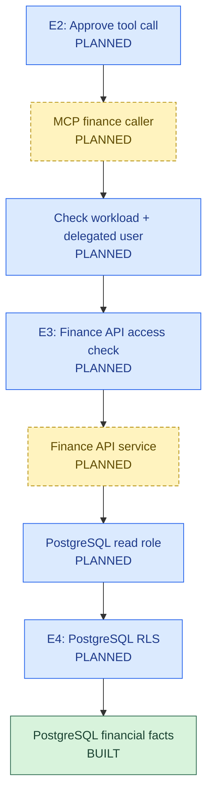
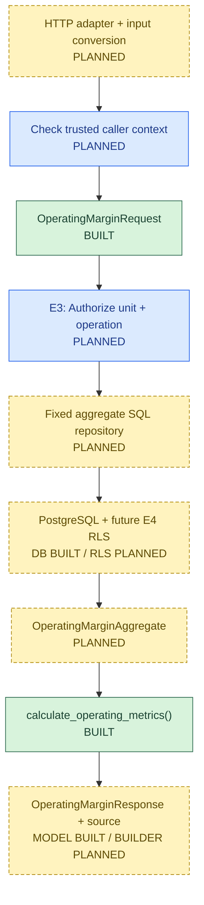
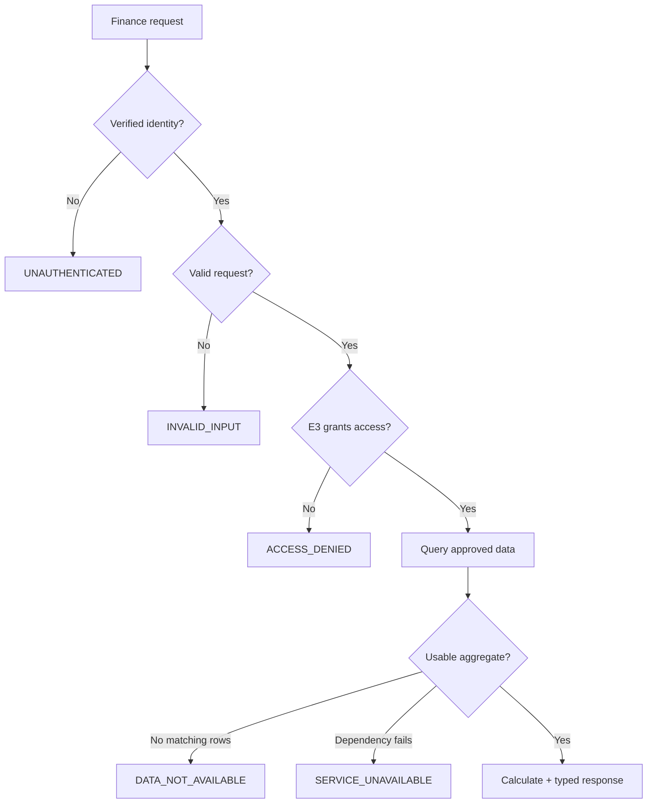

# 03. Finance API Architecture and Implementation

**FIN-AI | Capability design + implementation record**
**Master design:** [01 Enterprise Architecture](01_Enterprise_AI_Application_Architecture.md) · **Data owner:** [02 Database](02_Database_And_Financial_Data_Foundation.md)

**Status:** Pydantic contracts and Decimal calculation **built and tested**. E3 authorization, service, PostgreSQL repository, HTTP, E4 RLS and operations **planned**.

## 1. Where Finance API fits



- This diagram shows the **planned request path**, not live controls. Aggregates return through the repository and service; the service calculates the result and returns it through MCP.
- **E3 is required even if E2 approved the request.** No agent or MCP tool gets direct database access.
- **Identity:** user permission and service/workload permission are different. A frozen Python object is **not** identity proof.

## 2. Finance API solution design



**Why this design?** We can test the Finance API service and E3 ordering **before opening an HTTP endpoint**. The model never calculates financial figures or creates SQL.

### Failure path



- Error flow is **designed**, not implemented. Invalid credentials must not reveal financial-data existence.
- Multiple currencies in one requested result are **not allowed**. The final public error classification should be reviewed before implementing the repository; do not silently merge them.

## 3. Detailed design: contracts, data and security

### 3.1 Existing code contracts

| Type / function | What it does | Built? |
|---|---|---|
| `OperatingMarginRequest` | Strict Pydantic input: business unit; positive year; quarter 1–4 | Yes; 16 contract tests include request/response/error cases |
| `OperatingMarginResponse` | Financial Decimal fields, optional margin, currency, source | Yes; **type checks do not verify formulas** |
| `FinanceApiErrorName` | Five public error names | Yes |
| `calculate_operating_metrics()` | Profit = revenue − expense; margin = profit/revenue × 100 | Yes; 10 tests |

- Inputs to the calculation function must be finite, non-negative `Decimal`, never float.
- Zero revenue gives **margin `None`**; expenses may still make profit negative.
- Margin rounds to **two percentage decimals**, `ROUND_HALF_UP`, a **provisional policy**.
- HTTP query strings such as `"2026"` must be explicitly converted to integers **before** strict Pydantic validation. No HTTP adapter exists yet.

### 3.2 Planned internal types

| Type | Created by | Used by | Why |
|---|---|---|---|
| `FinanceRequestContext` | Future trusted inbound adapter | E3/service | Carry verified principal, workload, allowed units, operation and trace ID. **Construction alone proves nothing.** |
| `AuthorizedOperatingMarginQuery` | E3 after approval | Repository via service | Carry exact authorized unit/year/quarter and calling context |
| `OperatingMarginAggregate` | PostgreSQL repository | Service | Carry currency, revenue, expenses and source, **not** profit/margin |
| `MonotonicDeadline` | Adapter | E3/service/repository | Share **one** remaining request timeout across steps |

**Service contract (planned):**

```python
get_operating_margin(
    request: OperatingMarginRequest,
    context: FinanceRequestContext,
    deadline: MonotonicDeadline,
) -> OperatingMarginResponse
```

- The service **must require** an E3 authorizer and repository dependency; no production allow-all path.
- E3 checks delegated authority independently through a trusted service token or authoritative entitlement lookup. IdP and entitlement source still open.
- Do not put passwords, access tokens or model-editable claims in trusted context.
- RLS will be extra database protection, not a substitute for E3. Pool connections must never leak a previous user's scope.

### 3.3 Reporting and query rules

| Rule | Initial development decision |
|---|---|
| Rows | `POSTED` only |
| Revenue | Sum `REVENUE` amounts |
| Operating expenses | Sum relevant `EXPENSE` amounts; **all expenses provisionally treated as operating** for current fixture |
| Scope | One E3-authorized business unit, one financial year and quarter |
| Currency | One currency only; no automatic FX |
| Empty result | **No matching rows ≠ valid zero total** |
| Query | Fixed, parameterized, one SQL aggregate statement; `READ COMMITTED` statement snapshot |
| Calculations | Python `Decimal`; never calculate in the LLM |
| Provenance | Copy safe source identifier from approved repository result; detailed lineage still open |

**Important:** Pydantic response validation does **not** prove `profit = revenue − expenses`. Future tests must compare PostgreSQL, calculation and response values.

## 4. Errors, deadlines and monitoring

### Public errors (proposed, not implemented)

| Error | HTTP | Meaning |
|---|---:|---|
| `INVALID_INPUT` | 400 | Bad request shape or values |
| `UNAUTHENTICATED` | 401 | Caller identity cannot be verified |
| `ACCESS_DENIED` | 403 | E3 refuses this business-unit operation |
| `DATA_NOT_AVAILABLE` | 404 | No authorized usable data after E3 check |
| `SERVICE_UNAVAILABLE` | 503 | Dependency or bounded operation fails |

- Response envelope: `error.name`, safe `message`, `correlation_id`, `retryable`.
- Never return internal SQL errors, credentials or the existence of a forbidden business unit.
- **Open detail:** Mixed-currency results are invalid data, not simply empty data. Confirm whether to use 404 or sanitized 503 before coding.

### Standalone Finance API deadline

| Step | Proposed limit |
|---|---:|
| Authentication + trusted context | 250 ms |
| E3 authorization | 250 ms |
| PostgreSQL repository (including safe retry) | 900 ms |
| Calculation + response/error serialization | 50 ms |
| Transport overhead + safety margin | 550 ms |
| **Total** | **2,000 ms** |

**These are design numbers, not measured SLOs.** Use one absolute monotonic deadline. At most one transient *read* retry if time remains. Never retry denial, invalid input, no-data or financial-calculation failure. Return a controlled error rather than invented, stale or LLM-generated finance values.

**Future observability:** correlation ID, safe subject/workload IDs, authorization result, query version, timings, result status; **never raw tokens or full financial documents**.

## 5. Code map and tests

| Part | File | Evidence/status |
|---|---|---|
| External contracts and error names | `finance_api/contracts.py` | Built; **16 tests** |
| Financial calculation | `finance_api/calculations.py` | Built; **10 tests** |
| Internal context, query, aggregate, deadline | `finance_api/context.py` | Planned |
| E3 authorizer | `finance_api/authorization.py` | Planned |
| PostgreSQL repository | `finance_api/repository.py` | Planned |
| Service orchestration | `finance_api/service.py` | Planned |
| HTTP adapter / authentication | Framework not selected | Planned |
| E4 RLS and read-only database role | Future database security work | Planned |
| Full Python project | Existing modules | **41 tests passed, 0 skipped** (recorded; **not** end-to-end API testing) |

## 6. Next build order

1. Build `context.py` with small, documented internal types. **No claim of authentication.**
2. Add E3 interface; require it in the service. Test that denial never reaches repository.
3. Implement a parameterized repository and test it against PostgreSQL.
4. Build service: **E3 → repository → Decimal calculation → response**. Test call order and arithmetic.
5. Implement real workload authentication/entitlement checks, read role, RLS and negative security tests.
6. Add an HTTP route **only after secure production wiring exists**. Then test errors, retries, cancellations and latency.

**Takeaway:** The Finance API contracts and calculation function work in isolation. **The authorized, database-backed API is not implemented yet.**
