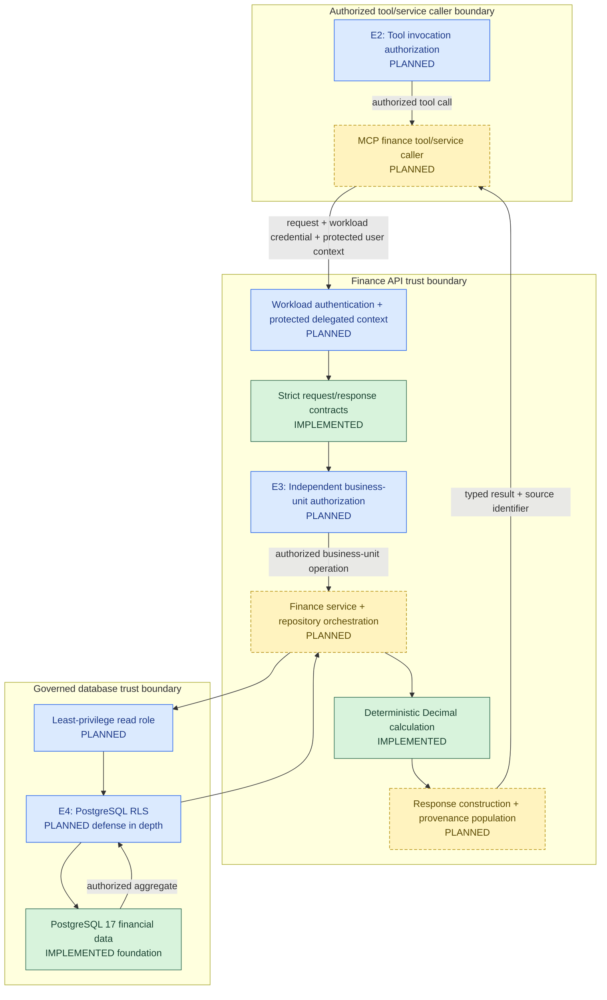
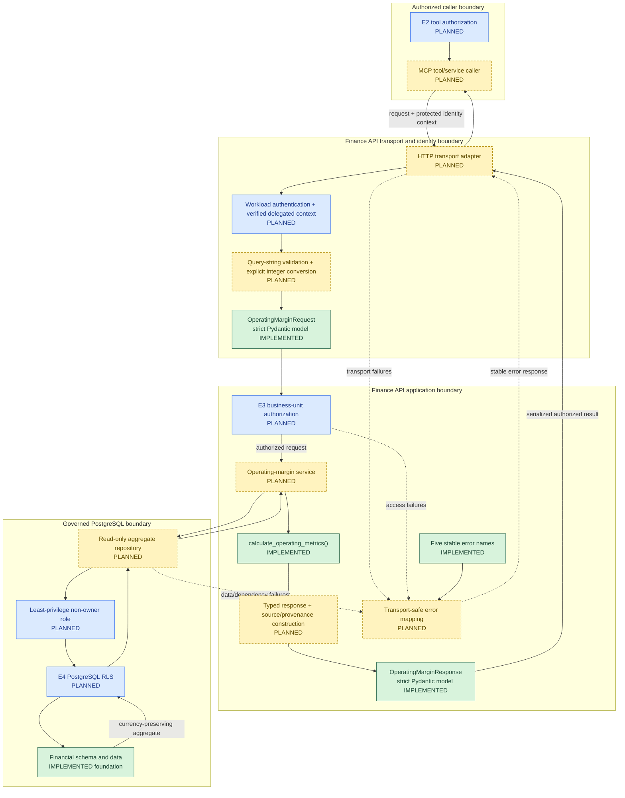

# Finance API Architecture and Implementation

**Project:** `Finance_Intelligence_And_Investigation_Platform`
**Scope:** Finance API contracts and deterministic operating-margin calculations
**Status:** Application-layer foundation implemented; API, database integration, and security controls planned

## 1. Capability Mapping to Enterprise Architecture

The Finance API is the deterministic service boundary between authorized FIN-AI tool callers and governed financial data. I implemented the strict Pydantic request and response contracts, stable error names, and Decimal operating-metric calculation. The HTTP operation, identity integration, E3 authorization, service orchestration, repository, database role, provenance population, and operational controls remain designed or planned.

In the approved enterprise flow, E2 authorizes a proposed finance tool invocation before the MCP caller reaches the service. That upstream decision is necessary but insufficient. The Finance API boundary must authenticate its workload caller and validate protected delegated-user context. E3 is then an unavoidable Finance API responsibility: the service must independently authorize the requested business unit and operation before any repository query. E4 is planned PostgreSQL RLS defense in depth after E3; it is not implemented and does not replace service authorization.



The diagram is a logical capability mapping, not a deployed network design. The delegated user identity establishes whose entitlement is being exercised; the workload identity establishes which trusted service is calling the Finance API. Neither a user-supplied identifier nor model-editable state proves identity. Credentials must not be forwarded to the LLM.

| Capability element | Enterprise responsibility | Status |
|---|---|---|
| Pydantic contracts and error names | Strict operation shape, immutable validated values, and stable error identifiers | Implemented and validated |
| Decimal calculation | Deterministic profit and margin arithmetic | Implemented and validated |
| MCP finance caller and E2 | Upstream allowlisted tool invocation and scope check | Designed/planned; not implemented |
| Finance API transport and verified context | Receive an authenticated workload call and protected delegated-user context | Designed/planned; not implemented |
| E3 Finance API authorization | Independently authorize principal, workload, operation, and business unit | Designed/planned; not implemented |
| Repository and read role | Execute only approved, parameterized financial aggregates | Planned; no repository or database role exists |
| E4 PostgreSQL RLS | Apply downstream row filtering as defense in depth | Planned; no policies or negative-access tests exist |
| Response and provenance flow | Return deterministic values, currency, reporting grain, and a source identifier | Contract implemented; construction and population planned |

PostgreSQL remains the governed source for persisted financial facts. The Finance API will be its only approved application read consumer; no direct MCP, agent, or model access to PostgreSQL is designed. The separate administrative ingestion path is outside this read-only capability and is documented in [02_Database_And_Financial_Data_Foundation.md](02_Database_And_Financial_Data_Foundation.md).

## 2. Finance API Capability Solution Architecture

The capability separates transport conversion, trusted identity handling, E3 authorization, governed aggregation, deterministic arithmetic, and response construction. Only the contracts, error names, and calculation function currently exist in Python.



HTTP query parameters arrive as strings. The planned adapter must validate and explicitly convert `financial_year` and `quarter` before constructing the strict request model; strict model validation will not be relaxed to absorb transport coercion. The protected identity context must remain separate from request data and model-editable content.

Every proposed database path passes through E3 before the repository and through the planned E4 boundary before PostgreSQL rows are returned. The repository must use a non-owner, non-`BYPASSRLS`, read-only role. Connection-pool handling must establish trusted transaction-local RLS context and clear it reliably, but no pool, role, context mechanism, or policy exists yet.

The return path carries authorized aggregates into the implemented Decimal function, then into a typed response. Pydantic validates response types; it does not prove the arithmetic or the relationship between database aggregates and calculated fields. Future integrated tests must reconcile those layers. Failures must use stable, authorization-safe semantics and must never substitute model-generated financial figures or root-cause explanations.

## 3. Finance API Detailed Solution Design

### 3.1 Component boundaries and responsibilities

The Finance API is designed as a framework-neutral application service with adapters around it. The service must not be reachable through an HTTP route until its production composition includes trusted authentication, mandatory E3 authorization, a parameterized repository, and safe error mapping.

| Boundary | Input | Output | Owns | Must not own |
|---|---|---|---|---|
| HTTP adapter | Raw query strings, headers, workload credential, cancellation signal | Parsed request values, transport response, or safe error envelope | Transport parsing, integer conversion, correlation ID, request deadline, HTTP serialization | Entitlement decisions, SQL, or financial arithmetic |
| Workload authentication and trusted-context provider | Workload credential and delegated authorization artifact | Validated authentication result and protected user context, or authentication failure | Credential validation appropriate to the selected token format and audience | Trusting model state, query fields, or an unsigned user-ID assertion |
| Strict Pydantic request model | Converted Python values | Frozen `OperatingMarginRequest` or `ValidationError` | Structural validation and rejection of unexpected fields | Authentication, authorization, existence checks, or data retrieval |
| E3 authorizer | Trusted context plus validated request | Authorized query scope or fail-closed denial | Independent workload, operation, and business-unit authorization | Treating E2 approval or request data as authority |
| Operating-margin service | Validated request, trusted context, absolute deadline, explicit authorizer and repository dependencies | `OperatingMarginResponse` or a typed domain failure | Required call order, calculation, response construction, and provenance population | Transport parsing, credential validation internals, or arbitrary SQL |
| PostgreSQL repository | E3-authorized query and remaining deadline | One currency-preserving aggregate, no-data result, or repository failure | Parameterized SQL, transaction boundary, snapshot, query timeout, and row-shape validation | User authentication, business policy, calculation, or error disclosure |
| E4 RLS boundary | Trusted transaction-local authorization context and read-only database role | Rows within permitted business-unit scope | Planned database defense in depth | Proving caller identity or replacing E3 |
| Calculation function | Revenue and operating-expense `Decimal` values | Operating profit and nullable margin percentage | Deterministic arithmetic and provisional rounding | Database access, authorization, or provenance |
| Response builder | Authorized aggregate, calculation result, request identifiers | Strict `OperatingMarginResponse` | Cross-field assembly, currency preservation, and source identifier | Claiming Pydantic has reconciled arithmetic |
| Error mapper | Typed validation, authentication, authorization, data, or dependency failure | Stable HTTP status and safe error envelope | Disclosure policy, retry flag, correlation ID, and internal logging classification | Returning stack traces, credentials, SQL details, or restricted-data existence |

The implemented public contracts remain:

| Contract | Implemented fields and rules | Boundary not owned by the model |
|---|---|---|
| `OperatingMarginRequest` | Trimmed nonempty `business_unit_code`; positive strict integer `financial_year`; strict integer `quarter` from 1 through 4; frozen; extra fields forbidden | Transport conversion, identity, entitlement, business-unit existence, and data availability |
| `OperatingMarginResponse` | Business unit, year, quarter, currency, four Decimal financial fields, nullable margin, and source; strict; frozen; extra fields forbidden | Aggregation, arithmetic reconciliation, authorization, and provenance population |
| `FinanceApiErrorName` | `INVALID_INPUT`, `UNAUTHENTICATED`, `ACCESS_DENIED`, `DATA_NOT_AVAILABLE`, and `SERVICE_UNAVAILABLE` | HTTP status, safe envelope, disclosure policy, logging, and retry classification |

HTTP query parameters arrive as strings. The future adapter must validate and explicitly convert `financial_year` and `quarter` before constructing the strict request model. No HTTP framework has been selected, and strict Pydantic validation will not be relaxed to perform transport coercion.

### 3.2 Internal service contracts

The planned service boundary should remain callable without HTTP so its authorization and orchestration behavior can be unit-tested first. Its conceptual contract is:

```python
get_operating_margin(
    request: OperatingMarginRequest,
    context: FinanceRequestContext,
    deadline: MonotonicDeadline,
) -> OperatingMarginResponse
```

The service constructor must require an E3 authorizer and an operating-margin repository; there must be no production constructor or overload that omits authorization. The service calls the authorizer before the repository. E3 returns an immutable `AuthorizedOperatingMarginQuery` containing the approved business unit, year, quarter, principal, workload, operation, and correlation identifier. The repository accepts that authorized query rather than raw HTTP values.

The repository returns either one immutable `OperatingMarginAggregate` or an explicit no-data result. The aggregate contains `business_unit_code`, `financial_year`, `quarter`, `currency`, `revenue`, `operating_expenses`, and a stable source identifier. It does not contain profit or margin because the implemented calculation function owns that arithmetic. Domain failures remain internal until the transport error mapper converts them to one of the five existing public error names.

These are proposed internal interfaces, not implemented classes. `MonotonicDeadline` denotes an absolute monotonic deadline rather than a new confirmed type or dependency; the implementation may use a small standard-library abstraction once the service code is created.

### 3.3 Trusted identity context and E3 authorization

The proposed internal context is a typed, immutable value containing only the fields required by this operation:

```python
@dataclass(frozen=True, slots=True)
class FinanceRequestContext:
    principal_id: str
    workload_id: str
    operation: Literal["get_operating_margin"]
    authorized_business_unit_codes: frozenset[str]
    correlation_id: str
```

A frozen type prevents accidental mutation after construction; it does not prove authentication. The context is trusted only when a Finance API inbound boundary constructs it from a successfully validated workload credential and delegated authorization artifact. It must never be created from model output, query parameters, conversation state, or an untrusted user-ID header. Bearer tokens and reusable credentials must not be placed in this context or forwarded to the LLM.

E3 does not accept “E2 approved this call” as authorization evidence. It must establish the authority of the delegated context through one of two proposed patterns once the identity design is selected:

1. Validate an audience-scoped, integrity-protected delegation artifact intended for the Finance API, including its issuer or trusted introspection authority, audience, validity, principal, workload binding, operation, and entitlement claims.
2. Validate the workload caller, then resolve current business-unit entitlements for the verified principal from an authoritative policy source.

In either pattern, E3 checks the exact operation and requested `business_unit_code`, fails closed on missing or ambiguous context, and produces the authorized internal query only after success. It must authorize before the repository reveals whether the unit, period, or data exists. The selected IdP, token format, token-exchange profile, authoritative entitlement source, claim freshness, revocation behavior, and cache policy remain open. JWT, token exchange, E3, and trusted-context construction are not implemented or tested.

### 3.4 Financial aggregation and snapshot policy

The initial approved development policy for the synthetic dataset is:

- Include only `POSTED` financial transactions.
- Aggregate `REVENUE` amounts separately from `EXPENSE` amounts.
- Treat all applicable `EXPENSE` records as operating expenses for the initial synthetic report.
- Restrict each operation to one E3-authorized business unit, one financial year, and one quarter.
- Return exactly one currency and never perform implicit FX conversion.
- Treat no matching transaction rows as data unavailable, not as zero revenue and zero expenses.

The operating-expense definition is provisional pending finance governance. A future governed rule may use `cost_categories.is_operating_cost`, ledger-account mappings, adjustments, or other accounting classifications. The initial implementation must make the current rule explicit rather than implying it is a final enterprise accounting policy.

The repository query must be parameterized and fixed in shape. Its parameters are the authorized business-unit code, financial year, quarter, and `POSTED` status; transaction type remains an allowlisted SQL aggregation rule rather than caller-provided SQL. The reporting grain is `(business_unit_code, financial_year, quarter, currency_code)`. The repository must reject or return a typed unusable-data result if more than one currency is present for that authorized grain; it must not merge currencies or select one arbitrarily.

One SQL aggregate statement should calculate revenue, operating expenses, row count, and currency grain. The row count distinguishes no rows from genuine rows whose aggregated value is zero. A selected period with transactions and zero revenue is valid input to the calculation function and produces a `None` margin; an empty selection produces `DATA_NOT_AVAILABLE` after authorization.

The initial repository should execute the aggregate as one statement using PostgreSQL's statement snapshot under the connection's configured `READ COMMITTED` behavior. E4 transaction-local context, when implemented, must be set inside the same short read transaction before the query. A future multi-statement report requires an explicit stronger snapshot decision. No repository query, reporting transaction, connection pool, read role, or RLS policy is implemented yet.

### 3.5 Deterministic calculation and response invariants

I implemented `calculate_operating_metrics(revenue, operating_expenses)` with Decimal-only inputs. It rejects non-Decimal, negative, `NaN`, and infinite values. It calculates operating profit as revenue minus operating expenses and calculates percentage margin as profit divided by revenue and multiplied by 100.

When revenue is zero, the function returns the calculated profit and `None` for margin because the percentage is undefined. Positive expenses with zero revenue therefore produce negative profit and no margin. Expenses greater than positive revenue produce negative profit and a negative margin. Percentage values use `ROUND_HALF_UP` to two decimal places as a provisional reporting convention; operating profit remains the exact Decimal difference.

The response builder must copy the authorized business unit, year, quarter, and currency from the repository result; use only the function's profit and margin outputs; and populate `source` from the repository's approved source identifier. Pydantic validates response types and immutability but does not enforce arithmetic or database-to-response consistency. Integration tests must reconcile the PostgreSQL aggregate, calculation result, response fields, currency, and reporting grain.

### 3.6 Public error contract and disclosure policy

The proposed transport envelope uses only the five existing error names:

```json
{
  "error": {
    "name": "ACCESS_DENIED",
    "message": "The request cannot be completed.",
    "correlation_id": "non-secret-correlation-id",
    "retryable": false
  }
}
```

The message must be stable and generic. It may identify a malformed field for `INVALID_INPUT`, but it must not echo credentials, SQL, internal exception text, entitlement details, or the existence of a restricted business unit. Detailed causes belong in access-controlled telemetry keyed by the correlation identifier.

| Error name | Proposed HTTP status | Owner | Disclosure rule | Client retry eligibility |
|---|---:|---|---|---|
| `INVALID_INPUT` | 400 | HTTP conversion and Pydantic boundary | Report only safe field/rule information | No; caller must change the request |
| `UNAUTHENTICATED` | 401 | Workload authentication and trusted-context provider | Do not disclose token-validation internals | No automatic retry; caller may reauthenticate |
| `ACCESS_DENIED` | 403 | E3 authorizer | Do not reveal whether the requested unit or data exists | No |
| `DATA_NOT_AVAILABLE` | 404 | Service after successful E3 authorization | State only that an authorized result is unavailable | No automatic retry unless product semantics later define data readiness |
| `SERVICE_UNAVAILABLE` | 503 | Service/repository dependency mapper | Do not expose connection, timeout, SQL, or infrastructure details | Conditional for a transient failure within the caller's deadline |

Authentication and E3 authorization always precede repository existence checks. An unauthorized request returns `ACCESS_DENIED` regardless of whether matching data exists. Missing rows, multiple currencies, or another result that cannot satisfy the single-currency response contract map externally to `DATA_NOT_AVAILABLE` only after successful authorization, while internal telemetry records the non-sensitive diagnostic classification.

### 3.7 Proposed latency and failure budget

I propose an initial **2,000 ms standalone Finance API deadline** for engineering and test design. This is not a measured value, an approved SLO, or a production commitment.

| Budget component | Proposed maximum | Included work |
|---|---:|---|
| Workload authentication and trusted-context validation | 250 ms | Credential validation or trusted introspection and protected context creation |
| E3 entitlement authorization | 250 ms | Delegated-authority verification or authoritative entitlement lookup |
| Repository and PostgreSQL query | 900 ms | Pool acquisition, transaction-local context, one aggregate statement, and any permitted transient retry |
| Calculation and response/error serialization | 50 ms | Decimal calculation, strict response construction, and serialization |
| Transport overhead and safety margin | 550 ms | Query parsing, scheduling, network variance, cancellation, and unused contingency |
| **Total** | **2,000 ms** | Standalone Finance API request deadline |

The HTTP adapter establishes one absolute monotonic deadline and passes the remaining time to authentication, E3, the service, and repository. A component may use a smaller local timeout but must not restart the full request budget. Database driver and statement timeouts must expire before the overall deadline so the service retains time to cancel work and return a controlled error.

Cancellation must propagate to in-flight entitlement and database operations. A cancelled or timed-out database transaction must roll back, and an unhealthy connection must not return to the pool with transaction-local E4 context. Connection acquisition or another clearly transient pre-result failure may receive at most one retry because this is a read-only operation, but only when sufficient deadline remains. Validation failures, authentication failures, authorization denials, no-data results, deterministic calculation failures, and requests for which a response may already have been emitted are not retryable.

Controlled degradation means returning the stable error contract. The service must not fabricate figures, invoke the LLM for replacement values, silently remove provenance, or fall back to stale cached data unless a separately governed freshness policy is approved. The future LLM investigation flow has a separate, materially longer end-to-end budget; it must allocate at most the standalone Finance API deadline to this tool call rather than treating model latency as part of the Finance API target.

### 3.8 Provenance and audit boundary

The current response exposes one `source` string. The repository should supply a stable, non-secret identifier for the PostgreSQL aggregate/query contract, and the response builder should copy it unchanged. This field does not provide full lineage and must not contain credentials, raw SQL, internal hostnames, or unrestricted source references.

Audit-safe telemetry should correlate the verified principal, workload, operation, authorized business unit, year, quarter, currency, authorization decision, repository/query version, result classification, latency allocation, and final error name through `correlation_id`. Successful response bodies do not currently contain that identifier, so a future HTTP adapter may return it in a response header without changing the implemented financial contract. Retention, redaction, access, and audit-storage policy remain open.

### 3.9 Implementation sequence and validation strategy

The next coding step should build the internal service boundary before any externally reachable route:

1. Add immutable internal context, authorized-query, aggregate, deadline, and typed domain-failure definitions in a small `finance_api/context.py` or equivalently focused module.
2. Add an E3 authorizer interface in `finance_api/authorization.py`; require it in the service constructor and prohibit a production allow-all implementation.
3. Add the repository interface and parameterized PostgreSQL implementation in `finance_api/repository.py`, keeping connection and transaction handling outside financial arithmetic.
4. Add `finance_api/service.py` to enforce E3-before-repository order, call the existing calculation function, construct the existing response model, and preserve source provenance.
5. Add unit tests for service orchestration with explicit test fakes, including proof that denial, invalid context, and expired deadlines never call the repository.
6. Add PostgreSQL integration tests for aggregation grain, `POSTED` filtering, no rows versus zeros, single-currency enforcement, parameterization, snapshot behavior, rollback, and dependency failures.
7. Implement the selected workload-authentication and entitlement adapters, least-privilege role, E4 policies, pool-context handling, and negative authorization/security tests.
8. Select an HTTP framework and add the adapter only after the production composition requires real authentication and E3 dependencies; then test conversion, status mapping, cancellation, deadlines, and safe error bodies.

Unit tests own deterministic service branching, dependency call order, calculation, response construction, error selection, and timeout/retry classification. Database integration tests own SQL behavior and transaction boundaries. Future security tests own forged context, invalid credentials, E2-approved/E3-denied calls, cross-business-unit access, RLS bypass roles, and pooled-context leakage. Test-only authorizers may be injected into unit tests, but they must not be selectable by production configuration or HTTP composition.

### 3.10 Principal decisions and trade-offs

| Decision | Status | Rationale | Trade-off or open point |
|---|---|---|---|
| Framework-neutral service before HTTP | Designed | Makes authorization and orchestration testable before exposure | Delays endpoint delivery until dependencies are explicit |
| Immutable typed context with trusted construction | Designed | Limits mutable identity state and clarifies required attributes | Python type construction alone cannot prove authentication |
| Mandatory E3 dependency | Designed | Prevents E2 or model intent from becoming service authority | Requires an IdP/delegation and entitlement decision |
| Strict Pydantic contracts | Implemented | Reject coercion, mutation, and unexpected fields | HTTP strings require explicit adapter conversion |
| Fixed parameterized aggregate query | Designed | Constrains query grain and keeps governed filtering close to data | Accounting and snapshot policies must remain synchronized |
| Initial all-expense operating-cost rule | Proposed development policy | Matches the approved synthetic scenario | Provisional until finance governance defines operating expense |
| Decimal-only calculation | Implemented | Preserves exact values and reproducible arithmetic | Callers must construct valid finite Decimal inputs |
| Planned E4 after E3 | Planned | Adds database defense in depth | Roles, policies, pool context, and bypass prevention remain open |
| Two-second standalone deadline | Proposed engineering budget | Gives each dependency a bounded share and preserves failure-handling time | Unmeasured and subject to workload and deployment evidence |
| One source string | Implemented contract | Provides a minimal origin field | Insufficient for complete lineage without telemetry and a source convention |

### 3.11 Design-to-code traceability

| Design responsibility | Source file or component | Implementation status | Required validation evidence |
|---|---|---|---|
| Strict request, response, and five error names | `finance_api/contracts.py` | Implemented and validated | 16 focused contract tests passed |
| Operating-profit and margin arithmetic | `finance_api/calculations.py` | Implemented and validated | 10 focused calculation tests passed |
| Existing contract and calculation behavior | Existing Finance API test modules | Validated | 26 focused tests; recorded full Python result is 41 passed with zero failures and zero skips |
| PostgreSQL financial foundation | Database schema and recorded reconciliation | Implemented and separately validated | Existing migration, integrity, import, and reconciliation evidence |
| Immutable request context and authorized internal query | Planned `finance_api/context.py` | Designed; not implemented | Unit tests for immutability, validation, trusted construction boundary, and no credential storage |
| Independent E3 authorization | Planned `finance_api/authorization.py` | Designed; not implemented | Unit and negative tests for workload, operation, business-unit scope, forged context, and fail-closed behavior |
| Operating-margin service | Planned `finance_api/service.py` | Designed; not implemented | Unit tests proving authorization precedes repository access and all response invariants hold |
| Parameterized aggregate repository | Planned `finance_api/repository.py` | Designed; not implemented | PostgreSQL integration tests for grain, filters, currencies, no-data semantics, snapshot, and failures |
| Least-privilege read role and E4 RLS | Future PostgreSQL security migration/configuration | Planned | Privilege, policy, bypass, cross-unit, and pooled-context negative tests |
| HTTP adapter and safe error envelope | Framework-specific adapter after framework selection | Planned | Transport conversion, status, disclosure, cancellation, deadline, and serialization tests |
| Latency, retry, and controlled degradation | Service, adapters, repository, and telemetry | Proposed; not measured | Deterministic timeout tests, transient-failure tests, and later representative load measurements |
| Provenance and audit correlation | Repository source convention and transport/telemetry adapters | Designed; not implemented | Integration tests for stable source and correlation without secret leakage |

The current implementation remains an application-layer foundation, not an integrated Finance API. No HTTP framework, endpoint, trusted-context provider, E3 authorizer, repository, database role, RLS policy, connection pool, or production observability component exists.

## 4. Deterministic Financial Calculations

I implemented `calculate_operating_metrics()` as a pure function with no Pydantic, PostgreSQL, MCP, LangGraph, or AWS dependency:

```python
def calculate_operating_metrics(
    revenue: Decimal,
    operating_expenses: Decimal,
) -> tuple[Decimal, Decimal | None]:
```

The function applies the following formulas:

```text
operating_profit = revenue - operating_expenses
operating_margin_percent = operating_profit / revenue * 100
```

It accepts only finite, non-negative `Decimal` inputs. Non-Decimal values, including floats and strings, negative values, `NaN`, and infinity raise `ValueError`. This avoids implicit binary floating-point precision loss and makes invalid calculations fail before they enter a response.

When revenue is zero, the function returns the calculated profit and `None` for the margin. It does not substitute `0%`, because the margin is undefined rather than zero. When expenses exceed revenue, negative operating profit and a negative margin are valid outputs.

I selected `ROUND_HALF_UP` and `Decimal("0.01")` as the initial reporting convention for percentage values. For example, a calculated `12.345%` rounds to `12.35%`. This policy is provisional: a future finance-control decision may specify a different rounding mode, currency-specific display rule, or reporting convention. Operating profit itself is not rounded by this function; it remains the exact Decimal difference of its inputs.

LLMs do not calculate finances in this architecture. A language model can later explain an already-approved calculation or help investigate evidence, but it must not become the source of revenue, expense, profit, or margin arithmetic. The calculation function and database aggregation provide reproducible behavior that can be directly tested and reconciled.

**Trade-off:** Keeping the calculation in Python makes the formula independently testable and reusable. PostgreSQL remains responsible for aggregating governed transaction facts. A future service must ensure both layers use consistent definitions for filters, posting status, currency, and report grain.

## 5. Planned Finance API Operation

The proposed operation is:

```text
GET /v1/finance/operating-margin
```

No endpoint exists yet. The proposed request mapping is:

```text
business_unit_code=EU&financial_year=2026&quarter=2
```

HTTP GET query parameters arrive as strings. Because `OperatingMarginRequest` deliberately uses strict integer fields, a future HTTP adapter or framework integration must explicitly validate and convert `financial_year` and `quarter` to integers before constructing the request model. I will not relax strict validation to accommodate transport input. This adapter is not implemented yet.

The proposed implementation sequence is:

1. Authenticate the workload and validate the protected delegated-user context.
2. Parse query-string values, explicitly convert integer fields, and construct the strict `OperatingMarginRequest`.
3. Apply E3 authorization for the principal, workload, operation, and business unit.
4. Query PostgreSQL through the planned repository, least-privilege role, and E4 RLS boundary for the approved reporting grain.
5. Pass the authorized aggregate `Decimal` values to `calculate_operating_metrics()`.
6. Construct `OperatingMarginResponse` with the requested identifiers, currency, calculations, and source provenance.
7. Map validation, authorization, data, and dependency failures to the published error contract without disclosing restricted data.

The proposed successful response maps directly to the current response model. The future repository, not the Pydantic request model, must determine whether a code exists and whether data is available. The future endpoint must not aggregate across currencies or business units without an explicit, authorized reporting rule.

## 6. Security and Authorization Design

All controls in this section are designed, not implemented.

The future API needs authentication and token validation before it evaluates financial access. A validated user identity and associated claims should propagate through the service layer without relying on caller-provided business-unit values as authority. The request's `business_unit_code` is a query parameter, not an entitlement.

Business-unit entitlements and role-based access control (RBAC) should determine whether a user can read a requested unit. A regional finance user and a global CFO may have different permitted scopes. The service should fail closed: a missing, invalid, or unrecognized identity/entitlement must not produce financial data. `UNAUTHENTICATED` and `ACCESS_DENIED` are reserved error names for that future behavior.

The database connection should use a least-privilege role limited to the required read operations. PostgreSQL Row-Level Security (RLS) can provide defense in depth, but no RLS policies or user-to-database identity mappings exist today. A future implementation may set an authenticated principal and permitted scope as transaction-local database context, then use RLS policies that reference that context. Transaction-local context is not proof of identity: verified identity and entitlements must originate at the authenticated application boundary. Database permissions and RLS configuration must also prevent unauthorized bypass paths. This design requires careful connection-pool reset behavior so one request's context cannot leak to another request. These controls are not yet implemented.

RLS must not be the only control. Service-level authorization provides meaningful API errors and protects application flow; database enforcement protects against a bypassing query path. Both require explicit negative-access tests before they can be considered effective.

## 7. Reliability and Operational Design

The implemented models provide stable error names, but they do not yet provide an HTTP error envelope or status mapping. The following is a proposed mapping, not implemented behavior:

| Error name | Proposed HTTP status |
|---|---:|
| `INVALID_INPUT` | 400 |
| `UNAUTHENTICATED` | 401 |
| `ACCESS_DENIED` | 403 |
| `DATA_NOT_AVAILABLE` | 404 |
| `SERVICE_UNAVAILABLE` | 503 |

`DATA_NOT_AVAILABLE` is returned only after successful E3 authorization, so the service does not query or disclose data existence to an unauthorized caller. The safe envelope, retry classification, and disclosure rules are defined in Section 3.6; none are implemented.

Section 3.7 proposes a 2,000 ms standalone Finance API deadline with component allocations, cancellation propagation, and a restricted transient read-retry policy. The value is an engineering proposal for implementation and testing, not a measured target or approved SLO. A future connection pool must safely reset transaction-local authorization context before reusing a connection.

Logging should record request correlation identifiers, validated non-sensitive request dimensions where authorized, selected error names, and dependency failures. It must not log secrets, raw tokens, or unnecessarily detailed financial payloads. Tracing should connect an API request to authorization, database access, and calculation execution; metrics should cover request volume, errors by class, component latency, deadline exhaustion, retries, database latency, and dependency saturation. Representative measurements are still required before approving an SLO or changing the proposed allocation.

## 8. Validation and Evidence

I validated the contract models with 16 focused tests. They cover valid requests, whitespace trimming, blank values, year and quarter bounds, boolean and string rejection, `None` rejection, extra-field rejection, frozen models, Decimal response values, float rejection, JSON Decimal serialization, nullable margin values, and stable error names.

I validated the calculation function with 10 focused tests. They cover the Europe Q1 and Q2 scenarios, zero-revenue behavior, loss scenarios, half-up percentage rounding, negative inputs, non-finite inputs, float and string rejection, and Decimal result types.

The project-level test result recorded for this milestone is **41 passed, 0 skipped**. This is a full-project result, not an API-only count. Exactly **26 tests** cover the Finance API contracts and calculation function; the remaining tests cover other project components. The 41-test aggregate was not used to claim endpoint, authorization, database-to-API, RLS, or resilience coverage.

Not tested yet:

- Immutable trusted-context construction, the E3 authorizer, and internal service orchestration.
- An HTTP endpoint and request routing.
- Authenticated and denied business-unit access.
- PostgreSQL aggregate retrieval into an API response.
- RLS behavior and transaction-local identity context.
- Connection pooling, timeouts, retries, and resilience behavior.
- Logging, tracing, metrics, and operational alerting.

**Takeaway:** The current evidence establishes the isolated Python contract and arithmetic behavior. It does not establish an integrated or production-ready Finance API.

## 9. Design Decisions and Trade-offs

| Decision | Implemented or proposed | Rationale | Main trade-off |
|---|---|---|---|
| Pydantic v2 contracts rather than dataclasses | Implemented | Strict validation, immutability, extra-field rejection, and JSON support at the boundary | Adds a dependency and runtime validation cost |
| `Decimal` rather than `float` | Implemented | Preserves exact decimal financial values and rejects accidental binary floats | Callers must construct Decimal values explicitly |
| Pure calculation function rather than LLM arithmetic | Implemented | Formula is deterministic, inspectable, and testable | Requires a separate evidence/LLM layer for narrative analysis |
| PostgreSQL aggregation with Python arithmetic | Proposed integration; both components exist separately | Database handles governed data selection and aggregation; Python owns reusable final arithmetic | Definitions and currency grain must be kept consistent |
| Separate contracts and calculations | Implemented | Each boundary can be validated without HTTP or database infrastructure | Service orchestration remains to be built |

## 10. Known Gaps and Next Steps

The following items remain planned work:

1. Implement the internal immutable context, E3 authorization interface, and operating-margin service with mandatory authorization dependency.
2. Implement the parameterized read-only PostgreSQL repository for the approved development aggregation policy and reporting grain.
3. Add service unit tests and PostgreSQL repository integration tests before exposing a transport route.
4. Select and implement workload authentication, delegated authority verification, business-unit entitlements, and fail-closed behavior.
5. Implement and validate the least-privilege database role, transaction-local context, and PostgreSQL RLS as defense in depth.
6. Select an HTTP framework and implement the adapter, safe error envelope, proposed deadlines, cancellation, and restricted retries only after the secured service composition exists.
7. Add negative authorization/RLS tests, controlled connection pooling, logging, tracing, metrics, alerting, and representative latency measurements.
8. Obtain finance governance decisions for operating-expense classification and rounding before treating either provisional rule as an enterprise reporting standard.

## 11. Takeaway

I implemented a narrow, testable Finance API foundation: strict Pydantic contracts, exact Decimal response handling, stable error names, and deterministic operating-margin calculation. PostgreSQL remains the governed source of financial facts, while the future API will orchestrate validated requests, authorized aggregation, deterministic calculation, and response serialization. Security, database integration, endpoint delivery, and operations are explicitly planned capabilities rather than implied by the current code.
