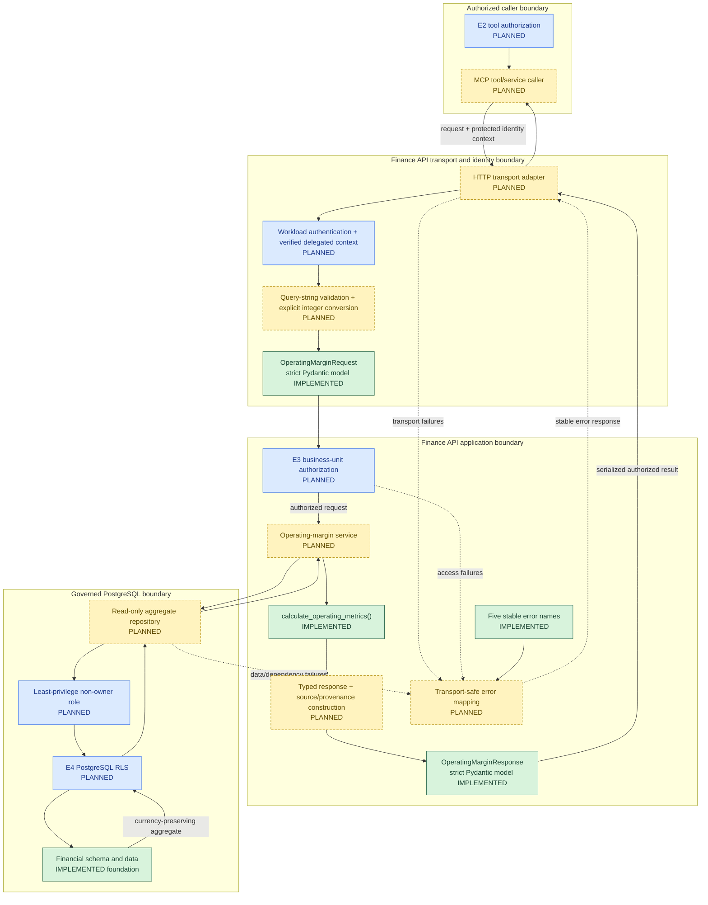

# Finance API Architecture and Implementation

**Project:** `Finance_Intelligence_And_Investigation_Platform`
**Scope:** Finance API contracts and deterministic operating-margin calculations
**Status:** Application-layer foundation implemented; API, database integration, and security controls planned

## 1. Capability Mapping to Enterprise Architecture

The Finance API is the deterministic service boundary between authorized FIN-AI tool callers and governed financial data. I implemented the strict Pydantic request and response contracts, stable error names, and Decimal operating-metric calculation. The HTTP operation, identity integration, E3 authorization, service orchestration, repository, database role, provenance population, and operational controls remain designed or planned.

In the approved enterprise flow, E2 authorizes a proposed finance tool invocation before the MCP caller reaches the service. That upstream decision is necessary but insufficient. The Finance API boundary must authenticate its workload caller and validate protected delegated-user context. E3 is then an unavoidable Finance API responsibility: the service must independently authorize the requested business unit and operation before any repository query. E4 is planned PostgreSQL RLS defense in depth after E3; it is not implemented and does not replace service authorization.

```mermaid
flowchart LR
    classDef implemented fill:#d8f3dc,stroke:#2d6a4f,color:#1b4332
    classDef planned fill:#fff3bf,stroke:#b08900,color:#5f4b00,stroke-dasharray: 5 3
    classDef control fill:#dbeafe,stroke:#2563eb,color:#1e3a8a

    subgraph CALLER["Authorized tool/service caller boundary"]
        E2["E2: Tool invocation authorization\nPLANNED"]:::control
        MCP["MCP finance tool/service caller\nPLANNED"]:::planned
    end

    subgraph API["Finance API trust boundary"]
        INBOUND["Workload authentication + protected delegated context\nPLANNED"]:::control
        REQUEST["Strict request/response contracts\nIMPLEMENTED"]:::implemented
        E3["E3: Independent business-unit authorization\nPLANNED"]:::control
        SERVICE["Finance service + repository orchestration\nPLANNED"]:::planned
        CALC["Deterministic Decimal calculation\nIMPLEMENTED"]:::implemented
        BUILD["Response construction + provenance population\nPLANNED"]:::planned
    end

    subgraph DATA["Governed database trust boundary"]
        READROLE["Least-privilege read role\nPLANNED"]:::control
        E4["E4: PostgreSQL RLS\nPLANNED defense in depth"]:::control
        PG["PostgreSQL 17 financial data\nIMPLEMENTED foundation"]:::implemented
    end

    E2 -->|"authorized tool call"| MCP
    MCP -->|"request + workload credential + protected user context"| INBOUND
    INBOUND --> REQUEST
    REQUEST --> E3
    E3 -->|"authorized business-unit operation"| SERVICE
    SERVICE --> READROLE
    READROLE --> E4
    E4 --> PG
    PG -->|"authorized aggregate"| E4
    E4 --> SERVICE
    SERVICE --> CALC
    CALC --> BUILD
    BUILD -->|"typed result + source identifier"| MCP
```



The diagram is a logical capability mapping, not a deployed network design. The delegated user identity establishes whose entitlement is being exercised; the workload identity establishes which trusted service is calling the Finance API. Neither a user-supplied identifier nor model-editable state proves identity. Credentials must not be forwarded to the LLM.

| Capability element | Enterprise responsibility | Status |
|---|---|---|
| Pydantic contracts and error names | Strict operation shape, immutable validated values, and stable error identifiers | Implemented and validated |
| Decimal calculation | Deterministic profit and margin arithmetic | Implemented and validated |
| MCP finance caller and E2 | Upstream allowlisted tool invocation and scope check | Designed/planned; not implemented |
| Finance API transport and verified context | Receive an authenticated workload call and protected delegated-user context | Designed/planned; not implemented |
| E3 Finance API authorization | Independently authorize principal, workload, operation, and business unit | Designed/planned; not implemented |
| Repository and read role | Execute only approved, parameterized financial aggregates | Planned; no repository or database role exists |
| E4 PostgreSQL RLS | Apply downstream row filtering as defense in depth | Planned; no policies or negative-access tests exist |
| Response and provenance flow | Return deterministic values, currency, reporting grain, and a source identifier | Contract implemented; construction and population planned |

PostgreSQL remains the governed source for persisted financial facts. The Finance API will be its only approved application read consumer; no direct MCP, agent, or model access to PostgreSQL is designed. The separate administrative ingestion path is outside this read-only capability and is documented in [02_Database_And_Financial_Data_Foundation.md](02_Database_And_Financial_Data_Foundation.md).

## 2. Finance API Capability Solution Architecture

The capability separates transport conversion, trusted identity handling, E3 authorization, governed aggregation, deterministic arithmetic, and response construction. Only the contracts, error names, and calculation function currently exist in Python.



HTTP query parameters arrive as strings. The planned adapter must validate and explicitly convert `financial_year` and `quarter` before constructing the strict request model; strict model validation will not be relaxed to absorb transport coercion. The protected identity context must remain separate from request data and model-editable content.

Every proposed database path passes through E3 before the repository and through the planned E4 boundary before PostgreSQL rows are returned. The repository must use a non-owner, non-`BYPASSRLS`, read-only role. Connection-pool handling must establish trusted transaction-local RLS context and clear it reliably, but no pool, role, context mechanism, or policy exists yet.

The return path carries authorized aggregates into the implemented Decimal function, then into a typed response. Pydantic validates response types; it does not prove the arithmetic or the relationship between database aggregates and calculated fields. Future integrated tests must reconcile those layers. Failures must use stable, authorization-safe semantics and must never substitute model-generated financial figures or root-cause explanations.

## 3. Finance API Detailed Solution Design

### 3.1 Request, response, and transport contracts

I selected Pydantic v2 for concise strict validation, immutable models, explicit rejection of unexpected fields, and predictable JSON serialization. The dependency is bounded as `pydantic>=2.12,<3`.

| Contract | Implemented fields and rules | Boundary not owned by the model |
|---|---|---|
| `OperatingMarginRequest` | Trimmed nonempty `business_unit_code`; positive strict integer `financial_year`; strict integer `quarter` from 1 through 4; frozen; extra fields forbidden | Transport conversion, identity, entitlement, business-unit existence, and data availability |
| `OperatingMarginResponse` | Business unit, year, quarter, currency, four Decimal financial fields, nullable margin, and source; strict; frozen; extra fields forbidden | Aggregation, arithmetic reconciliation, authorization, and provenance population |
| `FinanceApiErrorName` | `INVALID_INPUT`, `UNAUTHENTICATED`, `ACCESS_DENIED`, `DATA_NOT_AVAILABLE`, and `SERVICE_UNAVAILABLE` | HTTP status, error envelope, disclosure policy, logging, and retry classification |

Strict integer validation rejects booleans and numeric strings. The future HTTP adapter must therefore convert validated query-string values to integers before model construction. This transport conversion is distinct from Pydantic validation and is not implemented.

The response retains financial values as `Decimal`; `model_dump_json()` represents them as JSON strings. `operating_margin_percent` accepts `None` for zero revenue. The response model validates field types and configuration only. It does not independently prove that profit equals revenue minus expenses or that the percentage matches those values.

### 3.2 Trusted identity and E3 authorization

The Finance API must receive a least-privilege workload credential and protected delegated-user context from an authenticated boundary. These identities are distinct: the workload identity authorizes the calling component, while the delegated identity and entitlements constrain whose business-unit access it may exercise. An untrusted user-ID header, request field, conversation message, or agent state is not identity proof.

E3 must independently authorize the authenticated workload, delegated principal, requested operation, and `business_unit_code` before repository execution, even when E2 previously approved the tool call. The service must fail closed when identity, entitlement, or context validation is missing or ambiguous and must avoid disclosing whether a restricted unit or dataset exists. Credentials and reusable tokens must never be exposed to the model. The final IdP, token profile, delegation mechanism, and entitlement source remain open; none of this authorization behavior is implemented or tested.

### 3.3 Service, repository, and financial aggregation

The planned service coordinates one named operating-margin operation. It must not accept arbitrary SQL or let an MCP caller define database filters beyond the published request. After E3 authorization, the repository will execute a parameterized read at the requested business-unit, financial-year, quarter, posting-status, and currency grain.

The initial reporting rule uses only `POSTED` transactions and separates `REVENUE` from `EXPENSE` amounts at the authorized reporting grain. The repository must preserve currency and must not combine currencies or business units without a separate governed policy. Because the response contains one currency, behavior for an authorized result containing multiple currencies must be defined before implementation rather than silently aggregating it. The final repository definition must also state explicitly whether operating expenses include every `EXPENSE` transaction or only categories marked as operating costs; no repository code currently resolves that choice.

No matching authorized rows is a missing-data condition, not a zero-value financial result. Authorization must be evaluated before data existence is reported. The service must not fabricate amounts, infer supplier root causes, or convert reconciled cost movements into causal conclusions. The exact repository query, reporting definition, and transaction snapshot policy remain planned.

### 3.4 Deterministic calculations and response invariants

I implemented `calculate_operating_metrics(revenue, operating_expenses)` with Decimal-only inputs. It rejects non-Decimal, negative, `NaN`, and infinite values. It calculates operating profit as revenue minus operating expenses and calculates percentage margin as profit divided by revenue and multiplied by 100.

When revenue is zero, the function returns the calculated profit and `None` for margin because the percentage is undefined. Positive expenses with zero revenue therefore produce negative profit and no margin. Expenses greater than positive revenue produce negative profit and a negative margin. Percentage values use `ROUND_HALF_UP` to two decimal places as a provisional reporting convention; operating profit remains the exact Decimal difference.

Pydantic response validation does not enforce these arithmetic relationships. The future service must construct the response from the authorized repository aggregate and function result, and integrated tests must reconcile PostgreSQL values, calculations, response fields, currency, and reporting grain.

### 3.5 Error semantics, reliability, and provenance

| Condition | Intended stable error | Responsibility and boundary |
|---|---|---|
| Invalid query conversion or request contract | `INVALID_INPUT` | HTTP adapter and Pydantic boundary; do not reach E3 or the repository |
| Missing or invalid caller identity | `UNAUTHENTICATED` | Inbound service authentication; fail closed |
| Valid identity without business-unit permission | `ACCESS_DENIED` | E3; do not query protected finance data |
| No authorized aggregate at the approved grain | `DATA_NOT_AVAILABLE` | Service/repository after authorization; do not invent zeros |
| Database timeout or unavailable dependency | `SERVICE_UNAVAILABLE` | Service error mapping; do not leak connection details |

The transport and service layers must apply bounded deadlines and propagate cancellation. The repository owns database query timeouts and safe connection handling. Retries, if adopted, must be limited to transient failures of this read-only operation and remain within the request deadline; validation and authorization failures are not retryable. No numerical latency objective, retry count, pool policy, or resilience behavior has been approved or measured.

The current response exposes one `source` string. A future service must populate it from the actual authorized data path using an approved stable identifier and correlate the request with audit-safe telemetry. The field is not a complete lineage model, and the current code does not populate or verify provenance. Logs and traces must not contain credentials, raw tokens, or unnecessarily detailed financial payloads.

### 3.6 Principal decisions and trade-offs

| Decision | Status | Rationale | Trade-off or open point |
|---|---|---|---|
| Strict Pydantic contracts | Implemented | Reject coercion, mutation, and unexpected fields | HTTP strings require an explicit adapter conversion step |
| Decimal-only arithmetic | Implemented | Preserve exact financial values and reproducible calculations | Callers must construct valid finite Decimal inputs |
| PostgreSQL aggregation with Python calculations | Designed | Keep governed filtering close to data and formula logic independently testable | Definitions, snapshots, and response invariants require integration tests |
| Independent E3 authorization | Designed | Prevent upstream tool approval or model intent from becoming service authority | Requires trusted identity propagation and an entitlement source |
| Finance API instead of direct agent SQL | Designed | Constrain query grain, authorization, errors, and provenance | Adds a service boundary and repository that remain unimplemented |
| Planned E4 RLS after E3 | Planned | Add row-level defense in depth | Policies, roles, pool context, and bypass prevention remain open |
| One source string in the response | Implemented contract | Provides a minimal origin field | Insufficient for complete lineage without a provenance convention |
| Provisional half-up percentage rounding | Implemented calculation | Supplies deterministic current behavior | Finance governance may select a different reporting convention |

### 3.7 Design-to-code traceability

| Design responsibility | Source file or component | Implementation status | Validation evidence |
|---|---|---|---|
| Strict request, response, and error-name contracts | `finance_api/contracts.py` | Implemented and validated | 16 focused contract tests passed |
| Request validation behavior | `tests/test_finance_api_contracts.py` | Validated | Strict types, bounds, trimming, immutability, extra fields, Decimal JSON, nullable margin, and error names covered |
| Operating-profit and margin arithmetic | `finance_api/calculations.py` | Implemented and validated | 10 focused calculation tests passed |
| Calculation edge cases | `tests/test_finance_calculations.py` | Validated | Q1/Q2, zero revenue, losses, rounding, invalid inputs, and Decimal outputs covered |
| PostgreSQL financial foundation | Database schema and recorded reconciliation | Implemented and separately validated | Database record documents migration, integrity, import, and reconciliation evidence |
| HTTP adapter and query conversion | Future transport component | Planned | No implementation or tests |
| Workload authentication and protected identity context | Future inbound service boundary | Designed/planned | No implementation or security tests |
| E3 business-unit authorization | Finance API policy enforcement | Designed/planned | No implementation or negative-access tests |
| Operating-margin service and response construction | Future application service | Planned | No database-to-response integration tests |
| Parameterized aggregate repository and read role | Future repository/database access | Planned | No query implementation, role definition, or integration tests |
| E4 PostgreSQL RLS | Future database policy | Planned | No policies, trusted context, or bypass tests |
| Error mapping, timeout/retry behavior, and provenance population | Future transport and service controls | Designed/planned | No resilience, observability, or lineage tests |
| Full Python project suite | Multiple project test modules | Recorded validation evidence | 41 tests passed with zero failures and zero skips; 26 are Finance API focused |

The current implementation is an application-layer foundation, not an integrated Finance API. No HTTP framework, endpoint, repository, authentication, authorization, RLS, connection pool, or production observability component exists.

## 4. Deterministic Financial Calculations

I implemented `calculate_operating_metrics()` as a pure function with no Pydantic, PostgreSQL, MCP, LangGraph, or AWS dependency:

```python
def calculate_operating_metrics(
    revenue: Decimal,
    operating_expenses: Decimal,
) -> tuple[Decimal, Decimal | None]:
```

The function applies the following formulas:

```text
operating_profit = revenue - operating_expenses
operating_margin_percent = operating_profit / revenue * 100
```

It accepts only finite, non-negative `Decimal` inputs. Non-Decimal values, including floats and strings, negative values, `NaN`, and infinity raise `ValueError`. This avoids implicit binary floating-point precision loss and makes invalid calculations fail before they enter a response.

When revenue is zero, the function returns the calculated profit and `None` for the margin. It does not substitute `0%`, because the margin is undefined rather than zero. When expenses exceed revenue, negative operating profit and a negative margin are valid outputs.

I selected `ROUND_HALF_UP` and `Decimal("0.01")` as the initial reporting convention for percentage values. For example, a calculated `12.345%` rounds to `12.35%`. This policy is provisional: a future finance-control decision may specify a different rounding mode, currency-specific display rule, or reporting convention. Operating profit itself is not rounded by this function; it remains the exact Decimal difference of its inputs.

LLMs do not calculate finances in this architecture. A language model can later explain an already-approved calculation or help investigate evidence, but it must not become the source of revenue, expense, profit, or margin arithmetic. The calculation function and database aggregation provide reproducible behavior that can be directly tested and reconciled.

**Trade-off:** Keeping the calculation in Python makes the formula independently testable and reusable. PostgreSQL remains responsible for aggregating governed transaction facts. A future service must ensure both layers use consistent definitions for filters, posting status, currency, and report grain.

## 5. Planned Finance API Operation

The proposed operation is:

```text
GET /v1/finance/operating-margin
```

No endpoint exists yet. The proposed request mapping is:

```text
business_unit_code=EU&financial_year=2026&quarter=2
```

HTTP GET query parameters arrive as strings. Because `OperatingMarginRequest` deliberately uses strict integer fields, a future HTTP adapter or framework integration must explicitly validate and convert `financial_year` and `quarter` to integers before constructing the request model. I will not relax strict validation to accommodate transport input. This adapter is not implemented yet.

The proposed implementation sequence is:

1. Authenticate the workload and validate the protected delegated-user context.
2. Parse query-string values, explicitly convert integer fields, and construct the strict `OperatingMarginRequest`.
3. Apply E3 authorization for the principal, workload, operation, and business unit.
4. Query PostgreSQL through the planned repository, least-privilege role, and E4 RLS boundary for the approved reporting grain.
5. Pass the authorized aggregate `Decimal` values to `calculate_operating_metrics()`.
6. Construct `OperatingMarginResponse` with the requested identifiers, currency, calculations, and source provenance.
7. Map validation, authorization, data, and dependency failures to the published error contract without disclosing restricted data.

The proposed successful response maps directly to the current response model. The future repository, not the Pydantic request model, must determine whether a code exists and whether data is available. The future endpoint must not aggregate across currencies or business units without an explicit, authorized reporting rule.

## 6. Security and Authorization Design

All controls in this section are designed, not implemented.

The future API needs authentication and token validation before it evaluates financial access. A validated user identity and associated claims should propagate through the service layer without relying on caller-provided business-unit values as authority. The request's `business_unit_code` is a query parameter, not an entitlement.

Business-unit entitlements and role-based access control (RBAC) should determine whether a user can read a requested unit. A regional finance user and a global CFO may have different permitted scopes. The service should fail closed: a missing, invalid, or unrecognized identity/entitlement must not produce financial data. `UNAUTHENTICATED` and `ACCESS_DENIED` are reserved error names for that future behavior.

The database connection should use a least-privilege role limited to the required read operations. PostgreSQL Row-Level Security (RLS) can provide defense in depth, but no RLS policies or user-to-database identity mappings exist today. A future implementation may set an authenticated principal and permitted scope as transaction-local database context, then use RLS policies that reference that context. Transaction-local context is not proof of identity: verified identity and entitlements must originate at the authenticated application boundary. Database permissions and RLS configuration must also prevent unauthorized bypass paths. This design requires careful connection-pool reset behavior so one request's context cannot leak to another request. These controls are not yet implemented.

RLS must not be the only control. Service-level authorization provides meaningful API errors and protects application flow; database enforcement protects against a bypassing query path. Both require explicit negative-access tests before they can be considered effective.

## 7. Reliability and Operational Design

The implemented models provide stable error names, but they do not yet provide an HTTP error envelope or status mapping. The following is a proposed mapping, not implemented behavior:

| Error name | Proposed HTTP status |
|---|---:|
| `INVALID_INPUT` | 400 |
| `UNAUTHENTICATED` | 401 |
| `ACCESS_DENIED` | 403 |
| `DATA_NOT_AVAILABLE` | 404 or 422, subject to product semantics |
| `SERVICE_UNAVAILABLE` | 503 |

The ambiguity for `DATA_NOT_AVAILABLE` is intentional. A missing business unit, missing period, or temporarily incomplete data source can have different product and information-disclosure implications. I have not selected a final mapping.

The future service needs bounded database and downstream timeouts, cancellation-aware request handling, and failure mapping that avoids leaking connection details or authorization boundaries. It also needs a connection-pooling strategy that safely resets transaction-local authorization context before reusing a connection.

Logging should record request correlation identifiers, validated non-sensitive request dimensions where authorized, selected error names, and dependency failures. It must not log secrets, raw tokens, or unnecessarily detailed financial payloads. Tracing should connect an API request to database access and calculation execution; metrics should cover request volume, errors by class, database latency, and dependency saturation. No numerical SLOs or latency budgets are approved or implemented. Any future budget should be based on expected consumer behavior, database measurements, and failure-recovery requirements.

## 8. Validation and Evidence

I validated the contract models with 16 focused tests. They cover valid requests, whitespace trimming, blank values, year and quarter bounds, boolean and string rejection, `None` rejection, extra-field rejection, frozen models, Decimal response values, float rejection, JSON Decimal serialization, nullable margin values, and stable error names.

I validated the calculation function with 10 focused tests. They cover the Europe Q1 and Q2 scenarios, zero-revenue behavior, loss scenarios, half-up percentage rounding, negative inputs, non-finite inputs, float and string rejection, and Decimal result types.

The project-level test result recorded for this milestone is **41 passed, 0 skipped**. This is a full-project result, not an API-only count. Exactly **26 tests** cover the Finance API contracts and calculation function; the remaining tests cover other project components. The 41-test aggregate was not used to claim endpoint, authorization, database-to-API, RLS, or resilience coverage.

Not tested yet:

- An HTTP endpoint and request routing.
- Authenticated and denied business-unit access.
- PostgreSQL aggregate retrieval into an API response.
- RLS behavior and transaction-local identity context.
- Connection pooling, timeouts, retries, and resilience behavior.
- Logging, tracing, metrics, and operational alerting.

**Takeaway:** The current evidence establishes the isolated Python contract and arithmetic behavior. It does not establish an integrated or production-ready Finance API.

## 9. Design Decisions and Trade-offs

| Decision | Implemented or proposed | Rationale | Main trade-off |
|---|---|---|---|
| Pydantic v2 contracts rather than dataclasses | Implemented | Strict validation, immutability, extra-field rejection, and JSON support at the boundary | Adds a dependency and runtime validation cost |
| `Decimal` rather than `float` | Implemented | Preserves exact decimal financial values and rejects accidental binary floats | Callers must construct Decimal values explicitly |
| Pure calculation function rather than LLM arithmetic | Implemented | Formula is deterministic, inspectable, and testable | Requires a separate evidence/LLM layer for narrative analysis |
| PostgreSQL aggregation with Python arithmetic | Proposed integration; both components exist separately | Database handles governed data selection and aggregation; Python owns reusable final arithmetic | Definitions and currency grain must be kept consistent |
| Separate contracts and calculations | Implemented | Each boundary can be validated without HTTP or database infrastructure | Service orchestration remains to be built |

## 10. Known Gaps and Next Steps

The following items remain planned work:

1. Implement the API route and HTTP framework integration.
2. Implement a read-only PostgreSQL repository/query for the approved operating-margin grain.
3. Add authentication, authorization, business-unit entitlements, and fail-closed behavior.
4. Implement and validate PostgreSQL RLS as defense in depth.
5. Add database-to-API integration tests and negative-access tests.
6. Add controlled connection pooling, timeouts, error handling, logging, tracing, metrics, and alerting.
7. Decide final reporting and rounding policy with finance stakeholders before treating the provisional `ROUND_HALF_UP` rule as a governed reporting standard.

## 11. Takeaway

I implemented a narrow, testable Finance API foundation: strict Pydantic contracts, exact Decimal response handling, stable error names, and deterministic operating-margin calculation. PostgreSQL remains the governed source of financial facts, while the future API will orchestrate validated requests, authorized aggregation, deterministic calculation, and response serialization. Security, database integration, endpoint delivery, and operations are explicitly planned capabilities rather than implied by the current code.
