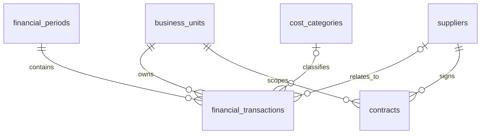
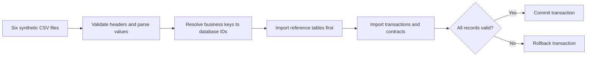

# Database and Financial Data Foundation

**Project:** `Finance_Intelligence_And_Investigation_Platform`
**Scope:** PostgreSQL 17, relational modeling, financial integrity, deterministic synthetic data, Python ingestion, SQL reconciliation, and query performance
**Document type:** Living architecture and learning reference

> **How to use this document:** Read each concept from first principles, follow the FIN-AI example, and use the **Takeaway** to summarize the design decision. Verified behavior is separated from planned capabilities. This file is intended to stand on its own for the concepts covered here.

## 1. The business problem and our architecture boundary

Meridian Global Manufacturing operates in Europe (EUR), India (INR), and the United States (USD). A CFO asks: **“Why did Europe's operating margin fall from 18% in Q1 2026 to 14% in Q2?”**

There are two different jobs:

1. **Establish the financial facts.** Calculate revenue, expenses, profit, margins, and cost variances from governed database records. This work must be deterministic: the same approved records and formula should give the same answer.
2. **Investigate the underlying causes.** Examine supplier contracts, pricing changes, operational records, and business context to determine *why* a cost changed. Future AI agents can help gather and synthesize that evidence, but should not invent financial figures or confuse a plausible explanation with a proven cause.

PostgreSQL 17 is our initial system of record for **structured synthetic financial data**. We chose it for relational joins, exact monetary types, transactions, constraints, triggers, SQL analytics, and a possible future row-level security (RLS) boundary. Contract **metadata** is stored in PostgreSQL; contract **documents and evidence retrieval** are future work.

**Why not introduce several databases immediately?** One relational database is understandable, testable, and sufficient for 216 current transactions. Additional stores, replicas, partitioning, or sharding should follow real requirements and measurements, not architecture fashion.

**Takeaway:** Keep governed facts and calculations separate from probabilistic AI reasoning. Add infrastructure only when a defined requirement justifies its complexity.

## 2. Relational data modeling

### 2.1 Tables, records, keys, and relationships

A **table** holds one kind of business information, a **row** is a record, and a **column** is a field. For example, `business_units` stores each unit's name and base currency; `financial_transactions` stores individual revenue and expense entries.

| Concept | Meaning | FIN-AI example | Why it matters |
|---|---|---|---|
| Primary key (PK) | Uniquely identifies a row within its table | `transaction_id` | Precisely identifies one record |
| Foreign key (FK) | References a PK in another table | `financial_transactions.period_id` | Prevents invalid relationships |
| Natural/business key | Stable identifier meaningful outside the database | `EU`, `2026-01`, `SUP-ALPINE` | Connects CSV data to business records |
| Surrogate key | Internal identifier allocated by the database | `business_unit_id BIGINT` | Efficient, stable internal referencing |
| Composite business key | Two or more fields jointly identify a record | `(business_unit_id, source_reference)` | Prevents duplicate source transactions per unit |
| Referential integrity | Every non-null FK points to a valid parent row | A transaction's `period_id` must exist | Preserves trustworthy joins |
| Normalization | Separate shared facts into related tables | Store a supplier name once in `suppliers` | Reduces repetition and contradictory updates |

**Worked example: natural key to surrogate key.** A CSV row contains `business_unit_code = EU`. PostgreSQL might assign Europe `business_unit_id = 7`. The importer looks up `EU`, receives `7`, and inserts `7` as the transaction's FK. It does **not** assume Europe must have ID `1`. Database sequences can have gaps, including after rolled-back work.

**Why normalize?** Imagine storing the supplier's name on 100 transactions. A name correction would require updating 100 rows, and partial updates could leave conflicting names. Keeping the supplier in one table avoids that inconsistency. The trade-off is that reports require `JOIN` operations to combine tables.

### 2.2 Our six-table model

| Table | Purpose | Example business identifier |
|---|---|---|
| `business_units` | Organizes ownership and base currency | `EU` |
| `financial_periods` | Defines each reporting month's dates, quarter, and close state | `2026-01` in the CSV |
| `cost_categories` | Names and classifies operating expenses | `LOGISTICS` |
| `suppliers` | Lists counterparties | `SUP-ALPINE` |
| `financial_transactions` | Stores revenue/expense facts by unit and period | `source_reference` scoped by unit |
| `contracts` | Links agreement metadata to suppliers and business units | `contract_number` |



A financial transaction **must** belong to a business unit and accounting period. Revenue has no expense category; expenses require one. Supplier references can be null where no supplier relationship exists. Contract rows presently represent **metadata**, not analyzed contract text.

**Takeaway:** Natural keys connect external systems; surrogate keys connect internal tables. Keys and relationships protect the meaning of our data.

## 3. Accurate money calculations and financial meaning

### 3.1 Why Python `Decimal` and PostgreSQL `NUMERIC(18,2)`?

A binary floating-point type such as Python `float` cannot represent every decimal fraction exactly. For example, monetary additions involving `0.1` and `0.2` can produce tiny representation differences. These are unacceptable as a default foundation for reconciled finance calculations.

Our design uses **`Decimal`** in Python and **`NUMERIC(18,2)`** in PostgreSQL. `NUMERIC(18,2)` has up to 18 total digits with two decimal places. We also validate imported monetary values to two decimal places rather than silently accepting arbitrary precision.

```python
from decimal import Decimal

revenue = Decimal("100000000.00")
expenses = Decimal("86000000.00")

profit = revenue - expenses
margin_percent = profit / revenue * Decimal("100")

print(profit)          # 14000000.00
print(margin_percent)  # 14.00
```

Amounts are stored as **positive magnitudes**; `transaction_type` determines whether each is revenue or expense. Financial analysis filters to `posting_status = 'POSTED'`. This is a simplified analytical model, **not** a complete double-entry general ledger or an implemented reversal/approval workflow.

### 3.2 Allocating a target amount without losing cents

Our generator distributes a known quarterly amount into monthly amounts, then into individual transactions. Rounding each portion independently can make the pieces add up to slightly more or less than the original.

For illustration, splitting €100.00 equally among three records yields €33.33 + €33.33 + €33.34, **not** €33.33 × 3 = €99.99. Our generator uses integer-based random weights, rounds intermediate allocations to cents, and assigns any remainder to the final entry. It preserves the exact approved total.

A fixed random seed makes the generated dataset reproducible: rerunning it with the same seed produces the same synthetic records. This is valuable for debugging and repeatable tests; it does not make the data representative of a live ERP system.

### 3.3 Financial formulas and the approved scenario

**Operating profit** = Revenue − Operating expenses
**Operating margin (%)** = Operating profit ÷ Revenue × 100

| Measure | Q1 2026 | Q2 2026 | Change |
|---|---:|---:|---:|
| Revenue | €100.0M | €100.0M | €0.0M |
| Logistics expense | €10.0M | €12.5M | +€2.5M |
| Raw-material expense | €35.0M | €36.5M | +€1.5M |
| Other operating expense | €37.0M | €37.0M | €0.0M |
| **Total expenses** | **€82.0M** | **€86.0M** | **+€4.0M** |
| **Operating profit** | **€18.0M** | **€14.0M** | **−€4.0M** |
| **Operating margin** | **18%** | **14%** | **−4 percentage points** |

Because revenue is constant at €100M, the €2.5M logistics increase explains **2.5 percentage points** of the margin decline, and raw materials explain **1.5 percentage points**. These are contributions to the observed *variance*, not proof of why those costs rose. A 4-percentage-point decline is not the same statement as a 4% relative decline.

Never combine EUR, INR, and USD amounts into a single monetary sum without an explicitly approved exchange-rate rule.

**Takeaway:** Exact money types and reconciled formulas establish *what changed*. Contracts and operational evidence are still needed to prove *why*.

## 4. Database integrity: constraints, foreign keys, and triggers

Application validation makes errors easier to understand, but an application can have bugs or be bypassed by another writer. The database must enforce important invariants for every writer.

An **invariant** is a rule that must always hold. For example, a transaction's posting date must fall within its referenced financial period.

| Mechanism | What it checks | Example |
|---|---|---|
| `NOT NULL` | Required column has a value | `posting_date` cannot be missing |
| `UNIQUE` | Business identifier cannot be duplicated | Unit + source reference |
| `CHECK` | A condition on the current row | `amount > 0`; valid transaction type |
| `FOREIGN KEY` | Referenced parent exists | `period_id` points to `financial_periods` |
| Trigger | Custom logic executed on changes | Reject posting date outside referenced period |

**Why a trigger for posting dates?** A `CHECK` constraint on `financial_transactions` cannot normally query another table to read `financial_periods.period_start` and `period_end`. We use two complementary triggers:

1. On inserting/updating a financial transaction, look up the referenced period and reject a date outside its boundaries.
2. On changing a period's boundaries, reject changes that would invalidate transactions already assigned to it.

The transaction-side trigger uses a row lock (`FOR SHARE`) to coordinate with concurrent period edits. This addresses a particular race; it does **not** establish that all possible concurrent workflows have been tested.

**Other rules not yet implemented:** authenticated access policies, enforcement of closed periods, approval workflows, reversal accounting, and audit history.

**Takeaway:** Use straightforward constraints for rules on a single row, FKs for relationships, and carefully tested triggers when the rule truly crosses tables.

## 5. Transactions and ACID

A **transaction** groups database statements into one logical unit. `COMMIT` makes its changes permanent; `ROLLBACK` reverses its uncommitted changes.

For a six-table import, inserting some reference records but failing to insert dependent transactions would create a misleading partial dataset. Therefore the importer wraps the complete load in **one PostgreSQL transaction**.

### The four ACID properties

| Property | Explanation | FIN-AI consequence |
|---|---|---|
| **Atomicity** | All operations in the transaction succeed together, or none is committed | Invalid transaction row rolls back earlier inserts from the same import |
| **Consistency** | Valid database rules remain satisfied as transactions commit | FKs, `CHECK` rules, and triggers reject invalid final states |
| **Isolation** | Concurrent transactions have controlled visibility and interaction | One import should not expose an intermediate, uncommitted partial load |
| **Durability** | Committed changes survive according to PostgreSQL's persistence guarantees | Successful committed finance facts remain stored |

**Isolation requires nuance.** ACID does not mean all concurrent transactions behave as if they ran serially under every setting. PostgreSQL offers isolation levels such as `READ COMMITTED`, `REPEATABLE READ`, and `SERIALIZABLE`, with different behavior and costs. We have not claimed or tested serializable isolation for the importer.

**Example:** Suppose the importer has inserted three new business units and then encounters an invalid financial amount. The database error aborts the transaction; no business units or other imported rows from that attempt should remain. Our database tests verified this rollback behavior for isolated test records.

**Important boundary:** A PostgreSQL transaction protects PostgreSQL changes. It does not automatically roll back a future S3 object upload, message sent to a queue, or update to SAP. Cross-system workflows will need separate recovery and idempotency strategies.

**Takeaway:** Choose a transaction boundary that matches the business consistency requirement, not merely the convenience of processing one file at a time.

## 6. Synthetic data as a controlled engineering fixture

The generator creates fictional Meridian Global Manufacturing records:

| Dataset | Records |
|---|---:|
| Business units | 3 |
| Financial periods | 6 |
| Cost categories | 3 |
| Suppliers | 8 |
| Financial transactions | 216 |
| Contract metadata | 4 |
| **Total** | **240** |

The 216 transactions span six months and three business units. Source references are reproducible; categories and suppliers reflect plausible manufacturing expenses; quarterly totals match our predetermined targets.

**Why use synthetic data?** It supports repeatable validation and safe GitHub publication without real corporate financial data. **What it does not prove:** real supplier causality, real-world distribution patterns, scale, or authorization of sensitive data.

**Takeaway:** Synthetic fixtures are excellent for correctness tests, but cannot substitute for representative performance and security testing.

## 7. ETL: from CSV to a relational database

**ETL** stands for **Extract → Transform → Load**. An ingestion pipeline takes source records, validates and converts them, resolves relationships, and persists the result.

Our flow:



### 7.1 Extract and validate

The importer checks that each CSV has its expected headers before connecting to PostgreSQL. It parses ISO dates, booleans, integer fields, and monetary `Decimal` values. An empty optional supplier/category reference becomes Python `None`, which Psycopg passes as SQL `NULL`.

**Why validate early?** We can reject malformed files with a clear error instead of discovering a failure halfway through an import.

### 7.2 Resolve natural keys to foreign keys

The CSV knows `EU` and `2026-01`; the target schema references numeric identities. The importer loads/looks up parent records and maintains maps from these business keys to the database's assigned IDs.

**Dependency order:** `business_units`, `financial_periods`, `cost_categories`, `suppliers` → `financial_transactions`, `contracts`.

### 7.3 Parameterized SQL

SQL text and parameter values are passed separately through Psycopg. For example:

```python
cursor.execute(
    "SELECT business_unit_id FROM public.business_units WHERE business_unit_code = %s",
    (business_unit_code,)
)
```

The `%s` placeholder is handled by the database driver. Do **not** concatenate untrusted values into SQL text. Credentials are read from environment variables; production-grade secret storage and least-privilege identities are future work.

### 7.4 Idempotency: safe repeat runs

**Idempotent** means that repeating the same operation has no additional intended business effect. It matters when a job is retried after a timeout or an operator reruns it without knowing whether the first attempt completed.

| Existing natural key? | Existing values match? | Importer's action |
|---|---|---|
| No | Not applicable | Insert record |
| Yes | Yes | Reuse existing row; no new insert |
| Yes | No | Raise `ImportConflictError` and roll back |

Our reimport of all six unchanged CSVs resulted in **0 inserted records and 240 recognized existing records**. This establishes safe *sequential* reruns for this dataset. It does not implement versioned updates, financial reversals, or safe concurrent writes by every possible writer.

**Why not just `ON CONFLICT DO NOTHING`?** Silently skipping an existing key could hide a changed amount for the same source transaction. Exact-value comparison exposes disagreement instead of concealing it.

### 7.5 Advisory lock: coordinating multiple importer processes

A **transaction-scoped advisory lock** is an application-defined PostgreSQL lock. Our importer requests the same lock ID before loading records. Cooperating importers using that ID wait rather than executing simultaneously; PostgreSQL releases the lock at transaction end.

This reduces concurrent importer races but has limits: another application that ignores the lock can still write to those tables. Unique constraints remain necessary as the database's duplicate-key safeguard. **Concurrent importer execution has not been independently tested yet.**

**Trade-off:** Row-by-row lookups make decisions explicit and understandable for our small dataset. Larger workloads may benefit from staging tables, bulk loading, or batching after measuring throughput and failure-recovery requirements.

**Takeaway:** A trustworthy loader checks data before writing, resolves identities correctly, commits atomically, rejects conflicting business keys, and supports safe retries.

## 8. SQL reporting: how to independently reconcile finances

A successful importer log reports that a program completed. **Reconciliation** checks whether persisted database records reproduce expected financial facts, independently of that program's messages.

### 8.1 The SQL operations, explained

| SQL construct | Meaning | Why our query needs it |
|---|---|---|
| `SELECT` | Choose columns or expressions to return | Display quarter, revenue, expenses, and margin |
| `FROM` | Identify the source relation | Start with transaction facts |
| `JOIN ... ON` | Match rows from related tables | Add business-unit and financial-period context |
| `WHERE` | Filter rows before grouping | Restrict to EU, EUR, 2026, and posted entries |
| `CASE WHEN` | Conditional value selection | Separate revenue amounts from expenses |
| `SUM` | Add numeric values | Calculate quarter totals |
| `GROUP BY` | Define the report's level of detail, or *grain* | Produce one result per quarter/currency |
| `NULLIF(x, 0)` | Return null when denominator is zero | Avoid divide-by-zero errors |
| `ORDER BY` | Sort final output | Q1 before Q2 |

**What is report grain?** It is what one output row represents. Our grain is **one quarter for Europe, in EUR**. Accidentally grouping different business units or currencies together can produce mathematically valid but financially meaningless results.

### 8.2 Query used to verify operating margin

```sql
SELECT
    fp.quarter,
    bu.base_currency AS currency,
    SUM(CASE WHEN ft.transaction_type = 'REVENUE'
             THEN ft.amount ELSE 0 END) AS revenue,
    SUM(CASE WHEN ft.transaction_type = 'EXPENSE'
             THEN ft.amount ELSE 0 END) AS expenses,
    ROUND(
        100.0 * (
            SUM(CASE WHEN ft.transaction_type = 'REVENUE'
                     THEN ft.amount ELSE 0 END)
            -
            SUM(CASE WHEN ft.transaction_type = 'EXPENSE'
                     THEN ft.amount ELSE 0 END)
        ) /
        NULLIF(SUM(CASE WHEN ft.transaction_type = 'REVENUE'
                        THEN ft.amount ELSE 0 END), 0),
        2
    ) AS operating_margin_percent
FROM public.financial_transactions ft
JOIN public.business_units bu
    ON ft.business_unit_id = bu.business_unit_id
JOIN public.financial_periods fp
    ON ft.period_id = fp.period_id
WHERE bu.business_unit_code = 'EU'
  AND fp.financial_year = 2026
  AND ft.posting_status = 'POSTED'
  AND ft.currency_code = 'EUR'
GROUP BY fp.quarter, bu.base_currency
ORDER BY fp.quarter;
```

**Reading the query:** It joins transactions to their owner and period; filters to approved posted European EUR records; sums revenue and expenses separately; computes margin; and returns one row per quarter. The explicit currency filter avoids accidentally accepting incorrectly coded data.

**Verified outputs:** Q1 revenue €100M, expenses €82M, margin **18%**. Q2 revenue €100M, expenses €86M, margin **14%**.

### 8.3 Cost-driver variance versus root-cause evidence

We separately grouped expense records by cost category and quarter. The database returned:

| Cost driver | Q1 | Q2 | Increase | Share of €4M increase |
|---|---:|---:|---:|---:|
| Logistics | €10.0M | €12.5M | €2.5M | 62.5% |
| Raw materials | €35.0M | €36.5M | €1.5M | 37.5% |
| Other operating costs | €37.0M | €37.0M | €0M | 0% |

These movements **fully reconcile** the €4M increase in total expenses. They **do not** show whether logistics rose because of rate increases, higher shipment volume, route changes, penalties, or something else. The later AI investigation must seek evidence for such hypotheses.

**Takeaway:** Validate financial answers by querying stored facts at the correct business-unit, period, status, and currency grain. A cost variance is a lead, not a proven cause.

## 9. Business-unit segregation versus actual security

We checked the persisted facts:

| Unit | Base currency | Transactions | Currency mismatches |
|---|---|---:|---:|
| EU | EUR | 72 | 0 |
| IN | INR | 72 | 0 |
| US | USD | 72 | 0 |

This proves that the **loaded fixture's transaction currency matches its owning unit's base currency**. It does **not** prove that the database enforces currency matching for every future writer, or that an India-only user is prevented from reading European finance records.

**Segregation** means data is labeled and organized by its owner. **Authorization** means a properly authenticated user is allowed to perform a particular operation on particular records. PostgreSQL **Row-Level Security (RLS)** can apply authorization policies at the row level, but our RLS policies, user identity mapping, and negative-access tests are **not implemented**.

Later, we must distinguish a regional finance user from a global CFO, verify both allowed and denied access, and address safe propagation of identity through application and agent layers.

**Takeaway:** A tenant/business-unit column is a prerequisite for isolation design, not proof that isolation is enforced.

## 10. PostgreSQL query performance: reading an execution plan

A query can be correct yet slow at scale. PostgreSQL's **query planner** evaluates candidate execution strategies using statistics and estimated costs. `EXPLAIN` displays its chosen strategy; `EXPLAIN ANALYZE` **actually runs** the query and reports measurements. `BUFFERS` adds page-access information.

### 10.1 A quick guide to plan terminology

| Term | Meaning | How to interpret it |
|---|---|---|
| `Seq Scan` | Read a table broadly, usually page by page | Often sensible for small tables or many matching rows |
| `Index Scan` | Use an index to locate rows | Useful when few rows match; has random-access costs |
| `Nested Loop` | For rows from one input, search the other | Good for small inputs or efficient indexed lookups |
| `Hash Join` | Build a hash structure on one input and match the other | Often good for joining manageable result sets |
| `Memoize` | Cache results of repeated parameterized lookups | Saves repeated work when keys recur |
| `Sort` | Arrange rows for ordering or grouping | Uses memory; large sorts may spill to disk |
| `HashAggregate` | Calculate groups using a hash table | Efficient when groups fit in memory |
| `GroupAggregate` | Aggregate rows already arranged by group | Often accompanies a sort or ordered scan |
| `cost=...` | Planner's relative estimated work | **Not milliseconds**, and not directly user latency |
| `rows=...` | Planner's estimated output rows | Compare with actual to assess estimate quality |
| `actual time=...` | Measured operator timing in milliseconds | A single run can vary |
| `loops=...` | Number of times the plan node executed | Multiply carefully when interpreting repeated work |
| `Buffers: shared hit` | Blocks found in PostgreSQL's shared buffer cache | Hits are not physical disk reads |
| `Buffers: shared read` | Blocks read into shared buffers | May be served by the OS cache, not necessarily physical disk |

**How to read a plan:** Start with lower/indented scan and join nodes to understand how rows were obtained. Follow them upward through joins, grouping, and sorting. Check estimated versus actual rows, filtering, and any unusually repeated or resource-intensive operations.

### 10.2 Our actual before/after measurement

After the 240-record import, we ran `EXPLAIN (ANALYZE, BUFFERS)` for the European quarterly revenue/expense query. Then we ran PostgreSQL `ANALYZE` on the three relevant tables and repeated the measurement.

| Observed item | Before statistics refresh | After statistics refresh |
|---|---|---|
| Execution time | **0.220 ms** | **0.157 ms** |
| Join strategy | Nested loops | Hash joins |
| Aggregation | GroupAggregate | HashAggregate |
| Key join estimated rows | 1 | 24 |
| Key join actual rows | 72 | 72 |
| Shared buffer hits during execution | 150 | 6 |
| Final result rows | 4 | 4 |

**What happened?** Initially the planner selected repeated lookups, including indexed primary-key access and a `Memoize` cache. After refreshed statistics, it chose hash joins and hash aggregation. Both plans returned the same four grouped results (two quarters × revenue/expense types).

**Why did estimates differ?** The planner works with estimates and may not fully account for correlations between columns such as business unit and currency. Even after the refresh, one estimate was 24 rows versus 72 actual rows.

**Do not overclaim:** A 0.157 ms single run is a useful **development baseline**, not evidence of production throughput, sustained latency, or guaranteed performance improvement. Buffer hits and timing also depend on cache state and execution conditions. At 216 fact rows, sequential scanning is reasonable and adding another index is not justified by these results.

### 10.3 What exactly does `ANALYZE` do?

`ANALYZE` collects/revises statistics about table content and distributions that the planner uses to estimate cardinalities and choose join/scan methods. It is not the same as creating an index, and it does not change financial record values. Autovacuum can run automatic analyze operations; manually refreshing after a representative data load is useful for investigation.

**Takeaway:** Tune from evidence. Verify the query's grain and filters, inspect the plan, refresh statistics where warranted, then benchmark with representative data before changing indexes or architecture.

## 11. Validation evidence and claim boundaries

| Validation | Observed result | What it establishes |
|---|---|---|
| PostgreSQL 17 V001 migration in Docker | Successful | Schema objects created |
| Database integrity tests | **27/27 passed** | Tested schema and trigger rules behave as expected |
| Synthetic generator tests | **11/11 passed** | Tested reproducibility, dates, references, precision, and totals |
| Importer PostgreSQL integration tests | **4/4 passed** | Tested load, exact-match rerun, conflict rejection, and rollback |
| Permanent import of six CSVs | **240 records inserted** | Synthetic data committed to the development database |
| Repeat import | **0 inserted, 240 existing** | No duplicates on this sequential rerun |
| Independent SQL reconciliation | **18% → 14%**; €4M cost increase | Stored facts match the approved scenario |
| Business-unit/currency check | **72 per unit; 0 mismatches** | Fixture's owner/currency associations match |
| `EXPLAIN ANALYZE` baseline | **0.220 ms**, then **0.157 ms** | Measured small-data plan behavior |

**Not yet proven or implemented:** Active RLS and delegated authorization; concurrent-writer safety testing; production-volume performance; auditing, controlled financial corrections and period close; disaster recovery; integration with actual SAP or other enterprise data; document-grounded supplier root causes.

A test pass is evidence only for its test conditions. We must continue to distinguish **design intentions**, **implemented controls**, and **independently verified behavior**.

## 12. Architecture decisions, trade-offs, and takeaways

| Decision | Reason | Main limitation |
|---|---|---|
| PostgreSQL as initial structured source | Strong integrity and familiar SQL | Document retrieval and future scaling need other components |
| Natural keys + `BIGINT` surrogate IDs | Stable source integration and safe internal relations | Must map keys during ingestion |
| `Decimal` + `NUMERIC(18,2)` | Precise, reconcilable monetary values | Currency-specific precision or complex accounting may require extensions |
| Constraints and selective triggers | Business rules apply regardless of client | Triggers require careful maintenance and concurrency testing |
| One import transaction | No partial six-table import | Larger loads may hold locks longer |
| Exact-match idempotency | Prevent duplicate runs and silent financial overwrites | Authorized updates need a separate, versioned path |
| Transaction-scoped advisory lock | Coordinates cooperating import processes | Other writers do not honor it automatically |
| Independent SQL reconciliation | Verifies persisted business meaning | Needs agreed accounting definitions and controlled report grain |
| Measure before indexing | Prevents premature tuning | Tiny synthetic runs do not predict enterprise performance |

### Practice explaining these decisions

**Q1. Why put constraints in PostgreSQL when Python already validates inputs?**
Because another importer, API, or direct database writer might bypass Python validation. Application checks give friendly early errors; database controls provide the shared integrity boundary.

**Q2. Why is a successful CSV import not sufficient proof of financial correctness?**
Because a program can complete while values are missing, duplicated, mislabeled, or incorrectly aggregated. Independent SQL reconciles persisted records against approved totals at the right business-unit and currency grain.

**Q3. Why does identifying €2.5M more logistics expense not establish the root cause?**
It quantifies the category movement, but it cannot distinguish contract-rate changes, shipment volume, routing, penalties, or other explanations. Supporting operational and contractual evidence is required.

**Q4. Why didn't we add an index when `EXPLAIN` showed a sequential scan?**
The table contains only 216 transaction rows. Sequential scanning can be cheaper than index traversal at that scale; the execution time was already very small. We need representative query load and growth before optimization.

### Compact mental model

**Reliable finance intelligence = correct relational facts + enforced invariants + atomic ingestion + safe retries + independent reconciliation + controlled authorization + evidence-backed investigation.**

## 13. How this document will evolve

Keep this as **one living document for the database and financial-data foundation**, updated when related work is actually implemented and validated. Future sections can explain RLS, delegated access, auditing, period close and corrections, more realistic query tuning, larger ingestion loads, recovery, and source-to-document evidence. Do not mark planned controls as completed.
